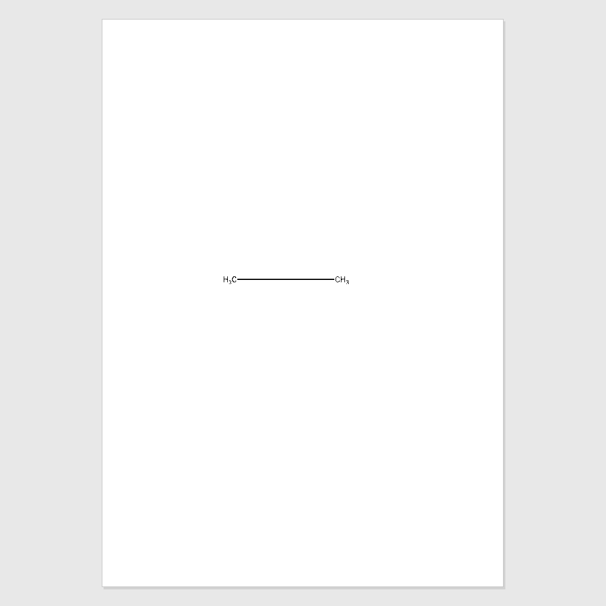

# Bondline

An independent, offline chemical drawing application being built in Rust.

[Source repository](https://github.com/thematheusmello/bondline) ·
[Build checks](https://github.com/thematheusmello/bondline/actions)

The compatibility target includes CDXML and CDX files used by ChemDraw Professional.
The first drawing workflow creates an independent C-C bond with terminal hydrogen labels,
supports Undo/Redo and captures its canvas on CPU or GPU. Connected construction and file
open/save remain missing. Drawings are session-local and cannot yet be saved/reopened.
The standalone CDXML crate preserves syntax and replaces existing attribute values without rewriting
unrelated bytes. A separate bounded writer and io encoder now produce new elemental CDXML
with explicit canvas extents; see [tested format scope](docs/file-formats.md).
The headless model stores validated atom/bond/fragment data. The io crate maps limited
source-backed node-position and elemental graph views. Engine snapshots/history now retain
complete original CDXML bytes, with guarded unchanged-source export. Application
import/save commands and faithful imported-file rendering are not yet connected.
History now counts shared source/model data once and evicts oldest snapshots at an
approximate 128 MiB retained-storage threshold; current data is always kept. This is not
a whole-process memory cap; see [the command contract](docs/control-protocol.md).
Bondline is not affiliated
with, endorsed by, or sponsored by ChemDraw or Revvity Signals.

Current capabilities: native page sizing/rotation and Undo/Redo, independently sourced Apache-2.0
font, original icon, shared CPU/GPU page-scene reference, and strict native runtime/asset
license gates. Native macOS drawing was visually inspected; hosted macOS/Windows tests and
three-frame window launches pass. Linux tests pass, but its window launch exposed a missing
system library; the CI correction awaits a rerun. This remains a development foundation with one limited
drawing workflow. The registry/CLI can inspect the document, size pages, create independent
bonds, undo/redo and capture supported scenes with revision/backend evidence.



This is the actual native document's offscreen canvas capture; window chrome is not included.
Its [approval record and exact scope](crates/render/tests/goldens/README.md) accompany the test.

```bash
cargo run -p bondline-ui --bin bondline
cargo run -p bondline-ui --bin bondline -- --smoke-test
cargo run -p bondline-cli -- commands
cargo run -p bondline-cli -- run --cmd '{"command":"page.set_size","params":{"page_id":1,"width_pt":612,"height_pt":792}}'
cargo run -p bondline-cli -- run --cmd '{"command":"bond.create","params":{"page_id":1,"begin_x_pt":100,"begin_y_pt":200,"end_x_pt":140,"end_y_pt":200}}'
cargo test --workspace --locked
cargo clippy --workspace --all-targets --locked -- -D warnings
cargo fmt --all -- --check
cargo xtask licenses
cargo xtask layers
cargo xtask corpus
cargo xtask ci
```

The smoke command launches the actual wgpu window, reports its adapter, and closes after
three frames. [The dependency policy](docs/dependency-policy.md) records pinned forks,
original compatibility adapters and verification limits. There is no license exception
for ISC, Boost, Zlib, Unicode or OFL. The hypothetical browser graph is not yet approved.
Agent clients can launch `cargo run --quiet -p bondline-cli -- mcp` as a stdio subprocess;
it opens its own in-memory document. See [the command contract](docs/control-protocol.md).
For the active desktop document, launch with `--control-port 0`; the app reports and displays
its loopback address and a fresh session token in startup stdout. This mode is opt-in;
protect that output as a credential. Authenticate each socket before sending bounded
newline JSON commands, as documented in [the command contract](docs/control-protocol.md).

Current work: the public menu/tool/shortcut inventory, broader file coverage and Linux
native-launch verification. [CI scope](docs/ci.md) separates configured jobs from evidence.
Workspace format/render tests need the pinned external consumers described in [development.md](docs/development.md).
See [STATUS.md](STATUS.md) for actual progress and [ROADMAP.md](ROADMAP.md) for the full target.

Original code is dual-licensed MIT OR Apache-2.0. Third-party notices remain with their files.
