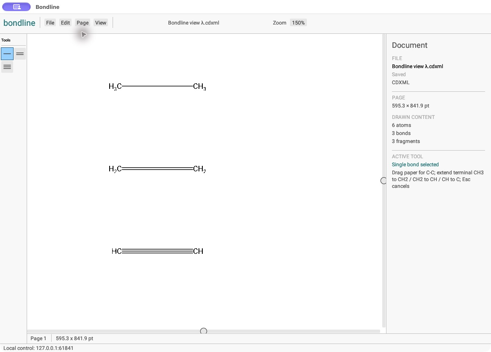
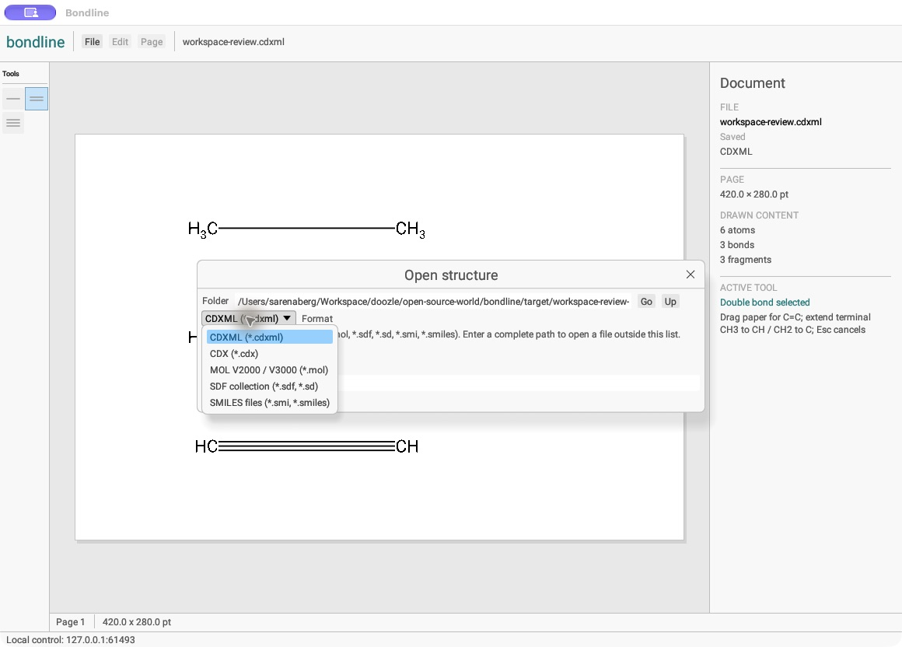

<p align="center">
  
</p>

<h1 align="center">Bondline</h1>
<p align="center">Free, open-source tools for drawing chemical structures and reactions.</p>

<p align="center">
  <a href="docs/ci.md"></a>
  <a href="LICENSE-MIT"></a>
  <a href="rust-toolchain.toml"></a>
  <a href="STATUS.md"></a>
</p>

<p align="center">
  <a href="#what-works-today">Features</a> ·
  <a href="#get-started">Get started</a> ·
  <a href="docs/README.md">Documentation</a> ·
  <a href="ROADMAP.md">Roadmap</a> ·
  <a href="CONTRIBUTING.md">Contributing</a> ·
  <a href="#license-and-credits">License</a>
</p>

Bondline is a native Rust desktop application with an offline command engine, editable
chemical documents and a thin egui/wgpu interface. No account or hosted service is needed
for ordinary drawing and saving.

**Early development:** Single/Double/Triple carbon drawing, existing-bond conversions,
1/2/3 order keys, Undo/Redo and editable CDXML saves have bounded native macOS checks.
Numeric zoom, Actual/Fit, pan and wheel navigation now make unchanged A4 paper usable
for the checked multiple-bond workflow. Small-ring tools and selection/movement have
shared-engine and actual-App checks; their native desktop interaction is still pending.
General labels and chemical analysis are still being built.
M1 file interoperability is the active implementation milestone; the complete M1–M5 target
is in [ROADMAP.md](ROADMAP.md). Full M0 is not yet complete.

**Current validation:** native macOS atom targeting, explicit element/H editing, Cancel,
Undo/Redo, draft-close protection and Unicode CDXML Save/reopen pass, with independent
checks of the actual files. See [atom-editor evidence](docs/verification-native-atom-labels.md),
[native record evidence](docs/verification-native-smiles-records.md) and the separate
[paste checkpoint](docs/verification-native-smiles-paste.md). The latest completed local
gate passes **1,470 tests, zero failures and one ignored test**, including formatting,
warnings-denied linting, layer/license checks and the pinned corpus. The
[carbon-label data increment](docs/verification-carbon-label-data.md) preserves standard
metadata; skeletal display remains unfinished. The historical intermittent MCP listener
failure remains unexplained; a passing gate is not a causal fix. Native2×/DPI, Fit and
complete pan behavior remain unverified or limited; see [density evidence](docs/verification-native-drawing-density.md).

<p align="center">
  
  <br>
  <sub>Actual macOS / Metal window at150%: original light workspace, unchanged A4 paper and a live document inspector.<br>The native-authored scene reopens for editing; rapid Undo→Save now preserves the expected drawing; <a href="docs/media/SOURCES.md">capture identity and limits</a>.</sub>
</p>

## What works today

| Capability | Delivered scope |
|---|---|
| Drawing and history | Drag a C–C bond and extend a supported terminal carbon with an explicit H policy. Native C3/C4 authoring, Undo/Redo and editable CDXML reopening are verified on macOS; general chemistry remains missing. |
| Double and Triple bonds | Native macOS tool selection, centered drawing, history and CDXML Save As pass at a readable scale. Carbon terminal extension also passes independent headless checks; its native multiple-bond workflow and context-sensitive styles remain unverified/missing. |
| Explicit sided doubles | Shortened Left/Right Double geometry, real gaps/hits and CPU/GPU capture pass independent engine/native-profile CDXML history and save/reopen checks. Native interaction, alignment controls and automatic styles remain unverified/missing. See [receiving](docs/verification-inset-doubles.md). |
| Existing-bond editing | Set Single/Double/Triple with hotspot1/2/3; convert an existing Single by clicking, or draw across Single/Double endpoints with Single selected. Same edge and geometry, corrected literal carbon H, one history step. Bounded native Mac and independent graph/file checks; alignment and general imported edits remain unavailable. |
| Small carbon rings | Six3–8 tools call the shared carbon Single-ring engine, with detached, shared-atom and shared-edge placements, complete previews and one-step history. Independent command/adapter and actual-App free/fused/spiro/Unicode-file checks pass; native OS interaction remains unverified. Aromatic/chair/sprout tools are still missing. See [receiving](docs/verification-native-rings.md). |
| Workspace | Light header, compact two-column bond/selection/ring rail, white paper, document/source/count inspector and contextual guidance. Actual macOS authoring and file-picker checks pass for the earlier documented subset; new selection/ring interaction still needs native review. |
| New document | File → New Document and Cmd/Ctrl+N start a fresh A4 drawing in the same window. Save, Discard and Cancel protect unsaved content. Mac SDF→New, dirty decisions, Unicode Save-before-New, editable reopening and Undo pass; styles/templates and multiple windows remain missing. |
| View navigation | Numeric zoom, Actual/Fit/Magnify/Reduce, two-axis position controls and ordinary wheel navigation without resizing paper or changing history. Mac A4 drawing/editing at100%/150% and read-only SDF Actual/pan pass. SDF Fit reports `Fit`, without an invented numeric percentage. SDF wheel and DPI/source invalidation pass actual-App tests; native wheel remains unverified. Rendering/readability guards apply. |
| Pages | A4 and Letter presets, rotation and validated physical dimensions. |
| CDXML files | Native Open, Save and Save As; editable reopening of proven Bondline-native files; unknown imported content remains backed by its original bytes. |
| MOL V2000 files | Source-preserving native Open/Save/Save As, retained headers/frame, explicit format choice and guarded close. Verified on macOS; one-fragment/layout/metadata limits apply. |
| MOL V3000 files | Native Open/Save/Save As and guarded close verified on macOS; retained source/headers, full-precision output and explicit versions. One-fragment/layout/metadata limits apply. |
| CDX files | Guarded native Open/Save/Save As verified on macOS. Canonical 28-byte implicit/explicit Document plus FileEnd passes independent tests and ASan; an original implicit-envelope file also passes bounded Mac Open/Unicode Save As/reopen with exact source retention. Its historical full local checkpoint passed1172/0/1. Limited projection; editing and faithful preview remain unavailable. |
| SDF files | Whole mixed-version collection Open/Save/Save As/reopen verified on macOS. Inspect duplicate, empty and space-only fields; edit an existing occurrence with explicit Apply and Undo/Redo. Record removal has confirmation, draft decisions, complete history and exact Save/reopen tests; at least one record must remain. A bounded native Mac Keep/Confirm→Undo/Redo→Unicode Save/reopen workflow passes. Default Fit can still refuse its readability guard. |
| SMILES records | Whole accepted `.smi`/`.smiles` source files and an original read-only ordinal inspector. Inspect exact notation/counts/ranges without disclosing opaque data. File → Import SMILES records… explicitly creates a supported selected/all-record drawing, described below. Raw Open alone does not create a drawing. Native OS clipboard copy from the inspector remains unverified. |
| SMILES file conversion | File → Convert SMILES file… offers Carbon chains, Acyclic neutral structures, Neutral ring structures and Neutral components. The fourth profile lays out supported trees/rings together, up to 64 total neutral H/C/N/O/F/Cl/Br/I atoms. Independent checks, its historical1188/0/1 checkpoint and bounded Mac conversion/refusal/retry, explicit Open/edit/history/Unicode Save/reopen pass. Native authoring worked at100%; the edited scene refuses Fit78.79%, and full overview/native pan remain unverified. Earlier profiles retain their own Mac evidence. Automatic clipboard conversion remains unavailable; retained-record editing and explicit Drawing paste are separate operations. |
| File protection | Explicit overwrite, unsaved-change decisions, guarded retries and close-Save receipts. Rapid Undo→Save preserves the undone source; independently checked in the actual Mac app and saved file. |
| Rendering | Shared CPU/GPU neutral-element scenes, centered multiple bonds, literal H, source-preserving derived MOL/SDF display H, component-aware hover and PNG captures. Drawing now generates fresh physical glyphs at exact DPI/device phase; renderer/App tests cover2× and fractional origins. Actual native2×/DPI remains unverified, and readability guards still apply. The centered style is original; broader native label workflows and reference style parity remain unverified. |
| Editable SMILES paste | Edit → Paste Special → SMILES… opens a bounded text/geometry form using the OS clipboard. Supported neutral structures, including benzene, append as one undoable edit through `structure.paste_smiles`. Mac refusal/retry/history/bond edit/Unicode Save/reopen and independent saved-file checks pass. Automatic clipboard capture, wider chemistry and exact reference-dialog parity remain unfinished. |
| Source-backed SMILES editing | File → Import SMILES records… and the CLI/MCP/loopback share explicit selected/all import and supported carbon bond-order edits. Bounded Mac refusal/retry, click/hotkey editing, Undo/Redo, Unicode Save As, raw reopen and explicit reimport pass; actual saved files retain opaque metadata and unselected records. Independent file checks and CPU/GPU captures pass. Selection is bounded to64 atoms/128 bonds. Geometry/record membership stay fixed; wider chemistry, native races and other platforms remain unfinished. |
| Elemental atom labels | Alt-click an existing atom/label, enter its element and explicit attached-H count, then Apply or Cancel. The shared `atom.set_label` preserves IDs, geometry and neighbors. Bounded macOS OH/NH2 editing, history, close protection and Unicode Save/reopen pass with independent actual-file checks. Source-free/native CDXML only; inline text, aliases, charges/isotopes/radicals and general H inference remain missing. |
| Selection and movement | Marquee, atom/bond/component click, Shift toggle and Select All call the shared selection registry. Drag selected atoms or nudge1pt/Shift10pt with one undoable literal-position edit. Independent commands, actual-App input, CLI/MCP/socket and Unicode file-consumer checks pass; native desktop interaction remains unverified. Native CDXML/source-free only; lasso, rotation, resizing, snapping and group workflows remain missing. |
| Ring construction engine | CLI/MCP/loopback `ring.create` authors3–8 carbon Single rings with explicit standalone, shared-atom or shared-edge placement. Fused/spiro geometry, literal H, history, source retention and Unicode files pass independent checks. Native ring tools, aromatic/chair/sprout workflows and general ring-system editing remain unfinished. |
| Automation | 38 typed commands in one registry, used by the UI, CLI, stdio MCP and opt-in authenticated localhost control. |

Native drawing/file workflows have been inspected on macOS. Earlier hosted CI tested all
three platforms and window launches. GitHub Actions is disabled during development to
avoid hosted-run costs; local checks continue. New hosted checks and interactive
Windows/Linux workflows remain unverified. [Verification evidence](docs/verification.md)
distinguishes those scopes.

The earlier Mac component review retains the scene's Fit78.79% refusal. Hotspot2 edits,
Undo/Redo, Actual100%, Unicode Save As/reopen and the independently checked9-atom/7-bond
output pass; two clicks with Double selected produced no mutation, with cause unresolved. This
does not verify a native Fit fix, physical density or full overview/pan.

<table>
  <tr>
    <td width="50%" valign="top">
      <h3>Keep the document</h3>
      Supported CDXML opens and saves with source data retained. Unsupported imported edits
      fail explicitly. Atomic publication, overwrite confirmation and a saved baseline protect
      the delivered file workflow.
      <p><a href="docs/file-formats.md">Format capabilities and limits →</a></p>
    </td>
    <td width="50%" valign="top">
      <h3>Inspect every command</h3>
      The native menus and shortcuts use typed engine bindings. CLI and MCP discover the same
      command schemas; localhost control can address the actual desktop session.
      <p><a href="docs/control-protocol.md">Automation contract →</a></p>
    </td>
  </tr>
</table>

<p align="center">
  
  <br>
  <sub>Actual native format chooser. Import/edit/preview limits differ by format; see the <a href="docs/file-formats.md">capability matrix</a>.</sub>
</p>

## Get started

Source builds are available now. Signed installers and browser delivery are planned in M5;
there is no published installer release yet.

```sh
git clone https://github.com/thematheusmello/bondline.git
cd bondline
cargo run --locked -p bondline-ui --bin bondline
```

Rust **1.94.1** is pinned by the repository. Linux prerequisites and the independent test
environment are documented in [development.md](docs/development.md). Python is used for
independent developer test oracles, not as an application runtime.

Use File → Open/Save/Save As for supported CDXML, CDX, MOL, SDF or SMILES documents. Cmd/Ctrl+O, S, Shift+S and W are wired;
actual Mac shortcut and accessibility-field evidence is in [native-file-ui.md](docs/native-file-ui.md).

Choose **File → New Document** or press **Cmd/Ctrl+N** to return to a fresh drawing.
For unsaved changes, choose **Save**, **Discard Changes** or **Cancel**. Save writes the
current document before creating the new one. [New document evidence](docs/verification-new-document.md)
separates the actual Mac workflow from headless race and lifecycle checks.

For an SDF collection, expand **Records**, choose **Inspect record … fields**, then expand
an occurrence in the right inspector. Duplicate names remain separate. Select **Edit record
… field …**, change the temporary text, then **Apply field value** and save the document.
Navigation with an unapplied change offers Apply, Discard or Cancel. Existing values stay
selectable and read-only until explicitly edited. [Inspector evidence](docs/verification-sdf-inspector.md)
and [editor checks and limits](docs/verification-sdf-editor-integration.md) distinguish native
observations from headless pagination and lifecycle checks.

To remove a whole SDF record, choose **Remove record …** in Records, resolve any changed
field draft, then confirm. **Keep record** cancels; **Undo** restores every original byte.
The remaining records receive new ordinal numbers. Removing the last record is refused.
[Removal verification](docs/verification-sdf-record-removal.md) separates App, worker and
actual desktop evidence; record creation/reordering and molecular editing remain missing.

If a fitted SDF preview reports that labels are too small, choose **View → Actual size**
or press **F5**, then use the two position controls. All records stay intact; the field
editor changes values and the chemical preview stays read-only. [View evidence and limits](docs/verification-sdf-view-integration.md)
separate the native Mac check from headless wheel/DPI checks.

For a SMILES file, enter **Record number** and choose **Inspect record**. **Previous record**
and **Next record** explicitly inspect a different ordinal. Select the read-only notation
and copy it normally; **Close record** hides it. Saving preserves the complete source,
including other records and opaque application data. [Verification and native limits](docs/verification-smiles-record-integration.md)
separate App tests from the observed inspector controls; raw Open alone implies no drawing.

To edit supported records, choose **File → Import SMILES records…**, select **One record**
with its ordinal or **All records**, and confirm the explicit geometry. The complete source
file stays attached, including unselected records and opaque data. Use **Actual size (F5)**
if Fit refuses a multiple-bond scene. Existing-bond keys1/2/3 and Single→Double clicks have
bounded Mac evidence; clicking an existing Double still reports unavailable alignment.
Undo/Redo and Save As operate on complete source. Reopening returns to raw-file mode;
explicitly import again to draw it. Generated coordinates are not stored in SMILES.
The [native record evidence](docs/verification-native-smiles-records.md) records bounds,
actual files and remaining native pan/DPI/race/reference-screen limitations.

To convert a supported structure, choose **File → Convert SMILES file…**. **Carbon chains**
retains the original1–12 neutral-carbon Single-path policy. **Acyclic neutral structures**
also supports branches, neutral H/C/N/O/halogens and Single/Double/Triple edges, up to64
atoms. **Neutral ring structures** supports one connected3–8-member Single cycle plus
supported attached trees, with the same64-atom neutral-element ceiling. **Neutral components**
adds one or more supported trees/rings, with 64 atoms in total. Actual edges determine
components, not dots; source identities and every atom/bond/H count stay intact. Fixed
poses use source-order shelves with a bond-length gap between atom-center boxes, without
rotation or scaling. Larger/polycyclic rings within a component, aromaticity, charges,
isotopes and unsupported Double configurations refuse the whole input.
Select an input and a **new** CDXML output path, review the point-based geometry, then
choose **Convert**. Acyclic, ring and component origins anchor the upper-left atom-center
bounds; the carbon-chain origin anchors an endpoint. Existing outputs are refused. Close the form and explicitly use
**File → Open** to edit the result; unsaved work is protected by the ordinary Open decision.
This is a restricted file utility, separate from clipboard paste and general SMILES import.
[Conversion evidence and limits](docs/verification-smiles-acyclic-integration.md) distinguish
the earlier Mac acceptance, independent readers and worker/race checks. The new
[single-ring integration record](docs/verification-smiles-ring-integration.md) separates
focused checks, its passing aggregate gate and bounded Mac acceptance from untested
native geometry entry, races and other platforms. The [component integration record](docs/verification-smiles-components-integration.md)
records focused/App checks, the full local1188/0/1 gate and bounded Mac refusal/retry,
guarded Open, Double edit/history and Unicode Save/reopen. Independent consumers verify
both actual native outputs. Authoring worked at100%, but the edited scene refuses Fit78.79%
under the existing distinct-pixel bond guard; an initial top label was clipped. Native pan
and a complete overview remain unverified. The atom ceiling does not guarantee paper/readability fit.

Select a bond tool and drag the paper. Over a supported carbon bond, press **1**, **2** or
**3** to set its order. Some clicks request alignment behavior that is still unavailable;
the app reports that gap. Choose **View → Actual size** or enter a readable **Zoom**
percentage. **F5/F6/F7/F8** select Actual/Fit/Magnify/Reduce. The view changes presentation
without changing paper dimensions. See [native view checks](docs/verification-view-native.md)
and [ordered saving](docs/verification-ordered-file-actions.md) for the exact workflows and limits.

```sh
# Discover the engine and the current control bindings.
cargo run --locked -p bondline-cli -- commands
cargo run --locked -p bondline-cli -- run --cmd '{"command":"ui.controls","params":{}}'

# Set presentation zoom through the same command as the native UI.
cargo run --locked -p bondline-cli -- run --cmd '{"command":"ui.view","params":{"action":"set_zoom","percent":150}}'

# Create a Double bond through the shared command; omitted order defaults to Single.
cargo run --locked -p bondline-cli -- run --cmd '{"command":"bond.create","params":{"page_id":1,"begin_x_pt":100,"begin_y_pt":200,"end_x_pt":140,"end_y_pt":200,"order":"double"}}'

# Convert a supported 1–12 carbon path into a new CDXML file, preserving input.smi.
cargo run --locked -p bondline-cli -- run --cmd '{"command":"file.convert_smiles_to_cdxml","params":{"expected_revision":0,"input_path":"input.smi","output_path":"new.cdxml","bond_length_pt":48,"origin_x_pt":72,"origin_y_pt":72,"page_width_pt":612,"page_height_pt":792}}'

# Create and export one explicitly identified fragment in the same headless session.
cargo run --locked -p bondline-cli -- run --cmd '{"command":"bond.create","params":{"page_id":1,"begin_x_pt":100,"begin_y_pt":200,"end_x_pt":140,"end_y_pt":200}}' --cmd '{"command":"file.export_smiles_fragment","params":{"expected_revision":1,"page_id":1,"fragment_id":1,"output_path":"ethane.smi"}}'

# Run a process-local stdio MCP session.
cargo run --locked -p bondline-cli -- mcp
```

Headless sessions do not pretend to open native dialogs. `ui.file` requires an attached
native host; explicit file commands remain available headlessly. To control the desktop
session, start it with `--control-port 0` and follow the [authentication protocol](docs/control-protocol.md).
Its startup token is a credential; keep it out of reports and screenshots.

## Files and the road ahead

| Area | Current state | Next work |
|---|---|---|
| CDXML | Source preservation, checked attribute changes, native elemental encoding and the supported app workflow | Broader source-preserving edits and mappings |
| CDX | Guarded shared/native Mac Open/Save and exact source retention. Additive canonical FileEnd envelopes pass independent syntax/IO/engine/CLI/MCP/socket and ASan checks; the original external implicit source passes bounded Mac Open/Unicode Save As/reopen. The [full local gate passes1172/0/1](docs/verification-cdx-file-end-integration.md); an earlier intermittent MCP failure remains unexplained. | Broader typed metadata/Text/Double/style mapping, faithful preview, editing/encoder and foreign/general corpus; all imports remain incomplete |
| MOL / SDF | MOL V2000/V3000 and mixed-version SDF native Mac files, existing-field editing, whole-record removal/Undo/Redo and bounded native SDF Actual/pan; independent byte/record/data and current-view image checks | Native wheel/DPI/edit-preview acceptance, record creation/reordering, field-header editing, broader metadata/layout support and interactive Windows/Linux |
| RXN | Source-preserving legacy container library with ordered roles and raw V2000/V3000 molecules; independent consumers | Reaction model, application/native files, V3000 reaction wrapper and broader extensions |
| SMILES | Complete accepted source-file Open/Save and readonly inspector; explicit selected/all retained Drawing import, supported carbon order/H edits, whole-source history/Save and bounded native Mac reopen/reimport. Independent actual-file consumers preserve opaque/unselected bytes. Explicit-H fragment export and four create-only layout converters remain separate | Broader chemistry/packing, record insertion/reorder/metadata editing, saved authoring geometry, native fragment export, automatic clipboard workflows and exact reference screens. Native Fit/pan/DPI/races and other platforms remain limited or unverified |
| InChI | Planned | Reference-tool comparison and import/export |
| Publishing | Page PNG capture exists | SVG/PDF/PNG publishing, printing and clipboard workflows |
| Web / installers | Planned M5 | Approved browser dependency graph, packaging and signing |

The compatibility target includes CDXML and CDX files used by ChemDraw Professional.
Bondline is independent and is not affiliated with, endorsed by or sponsored by ChemDraw
or Revvity Signals. Reference names identify compatibility; no reference icons, fonts,
templates or application assets are bundled.

## Engineering and verification

The engine is independent of the GUI. Cargo enforces the crate layers; standalone format
crates preserve unknown data. Complete document snapshots support history, and immutable
background plans keep I/O and rendering outside the engine lock.

After setting up the pinned [external test consumers](docs/development.md):

```sh
cargo fmt --all -- --check
cargo clippy --workspace --all-targets --locked -- -D warnings
cargo test --workspace --locked
cargo xtask ci
```

GitHub Actions is disabled during development to control costs. Run the local checks
above; hosted checks will be restored when the project is complete. See [CI policy](docs/ci.md).

The aggregate also checks layers, declared native dependency licenses, bundled assets and
the pinned corpus. Current corpus coverage is limited: a passing gate is not full format or
chemistry parity. Parser fuzzing has its own [bounded workflow](fuzz/README.md).

| Read | Purpose |
|---|---|
| [STATUS.md](STATUS.md) | Exact integrated checkpoint, evidence and next executable tasks |
| [ROADMAP.md](ROADMAP.md) | Complete M0–M5 target |
| [Architecture](docs/architecture.md) | Crate responsibilities, commands and data ownership |
| [Parity checklist](docs/parity-checklist.md) | Sourced feature inventory with explicit missing/wired/verified states |
| [Source register](docs/clean-room/sources.md) | Public specifications and provenance decisions |
| [CI evidence](docs/ci.md) | Actual platform results and their limits |

## Contribute

<a href="CONTRIBUTING.md"></a>

Chemists, Rust developers, documentation writers and test authors are welcome. Pick a
concrete gap, cite its public source and bring an independent test. Small contributions
are useful: a clear reproduction, an original licensed fixture or a corrected workflow
record can move the project forward.

Start with [CONTRIBUTING.md](CONTRIBUTING.md). Use the [issue forms](https://github.com/thematheusmello/bondline/issues/new/choose)
for bugs and feature requests, [SUPPORT.md](SUPPORT.md) for questions and
[SECURITY.md](SECURITY.md) for private vulnerability reporting. Parallel agent contributors
follow the same [AGENTS.md](AGENTS.md), file ownership and verification rules.

## License and credits

Original Bondline code and documentation are dual-licensed under **[MIT](LICENSE-MIT) OR
[Apache-2.0](LICENSE-APACHE)**, at your option. Copyright © 2026 Bondline contributors.

Third-party software and fonts retain their notices. See [NOTICE](NOTICE),
[ATTRIBUTION.md](ATTRIBUTION.md) and the [dependency policy](docs/dependency-policy.md).
The banners are original project artwork; the screenshots show Bondline itself.
Their [sources and hashes](docs/media/SOURCES.md) are recorded separately from the approved
render-test golden. No paid service or copied reference artwork is required.
