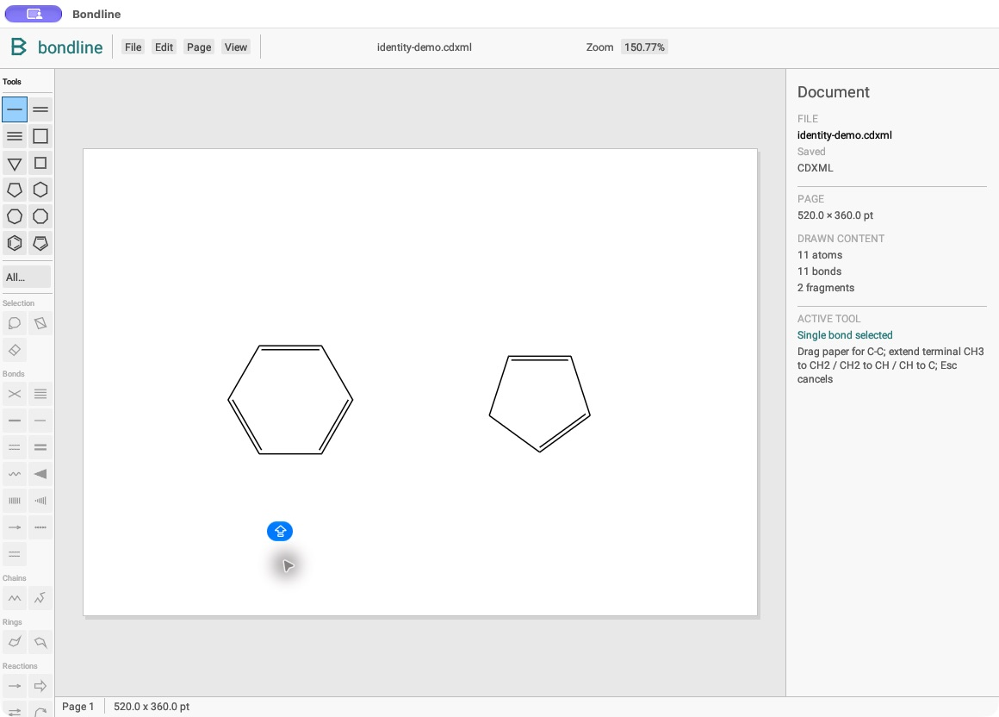
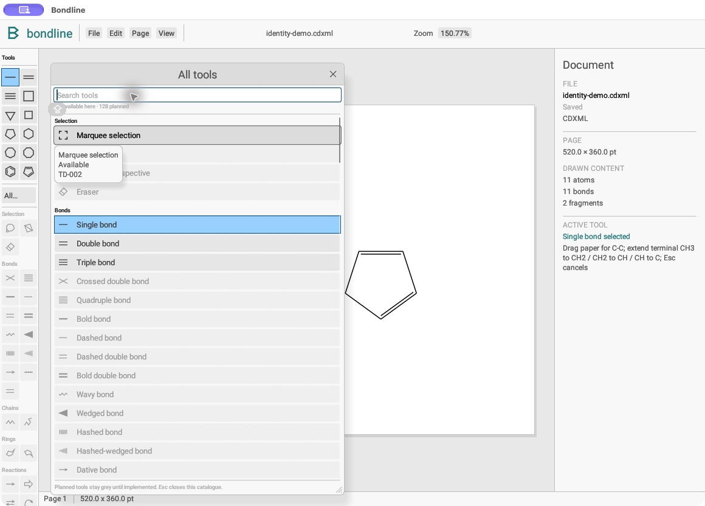

<p align="center">
  
</p>

<h1 align="center">Bondline</h1>
<p align="center">Free, open-source tools for drawing chemical structures and reactions.</p>

<p align="center">
  <a href="docs/ci.md"></a>
  <a href="LICENSE-MIT"></a>
  <a href="rust-toolchain.toml"></a>
  <a href="STATUS.md"></a>
</p>

<p align="center">
  <a href="#what-works-today">Features</a> ·
  <a href="#get-started">Get started</a> ·
  <a href="docs/README.md">Documentation</a> ·
  <a href="ROADMAP.md">Roadmap</a> ·
  <a href="CONTRIBUTING.md">Contributing</a> ·
  <a href="#license-and-credits">License</a>
</p>

Bondline is a native Rust desktop application with an offline command engine, editable
chemical documents and a thin egui/wgpu interface. No account or hosted service is needed
for ordinary drawing and saving.

**Early development:** Single/Double/Triple carbon drawing, existing-bond conversions,
1/2/3 order keys, Undo/Redo and editable CDXML saves have bounded native macOS checks.
Numeric zoom, Actual/Fit, pan and wheel navigation now make unchanged A4 paper usable
for the checked multiple-bond workflow. Small-ring tools have shared-engine and actual-App
checks; broader native interaction remains pending. Marquee selection/movement now has
bounded macOS click/Shift/rectangle/component, drag/nudge/history and editable persistence
checks. A bounded
macOS Benzene click/Undo check now passes in the updated workspace.
Native Acyclic/Snaking chains now have bounded macOS drawing, Add Chain, repeat,
attachment, preference, history and editable Save/reopen checks.
Both original cyclohexane-chair tools now have bounded macOS horizontal/rotated drawing,
terminal attachment, contextual9/0 fusion, history and editable Save/reopen checks.
Their perspective depictions leave stereochemistry unspecified.
Atom-targeted Alt-sprout and a session Preferences checkbox now share the same guarded
ring engine, with bounded macOS drawing, history and editable Save/reopen checks.
In supported skeletal CDX drawings, Alt-click a printed atom label to change its element and attached hydrogen count. The edit follows the atom after a move and survives Undo, Redo, Save As and reopen. [Supported drawings and verification](docs/verification-cdx-skeletal-label-edits.md).

The shared `atom.create_authored_label` command can also print a heteroatom at an eligible hidden carbon in a supported CDX drawing. The writer uses the drawing’s font and palette. Four byte-checked examples cover first and last hidden atoms, pre-existing hydrogen counts, and coloured type. [CDX label creation examples](crates/io/tests/fixtures/cdx-skeletal-label-creation/SOURCES.md).

Use **View → Show Analysis Window** to read the formula, molecular weight, monoisotopic exact mass and elemental percentages by weight of a supported drawing or its selected atoms. The panel identifies missing atomic data and valence-based hydrogen counts in skeletal CDX and elemental V2000/V3000 MOL. Selecting ethanol’s oxygen gives `HO`. Including its adjacent carbon gives `CH3O`. [Analysis](docs/research/analysis-window.md) · [Mass conventions](docs/research/molecular-masses.md) · [MOL examples and limits](docs/verification-mol-analysis.md) · [Elemental analysis](docs/verification-elemental-analysis.md).
M1 file interoperability is the active implementation milestone; the complete M1–M5 target
is in [ROADMAP.md](ROADMAP.md). Full M0 is not yet complete.

**Current validation:** qualified imported CDXML diagrams support explicit labels and
explicitly hidden, known-H carbons with proven styles and glyph-margin clearance.
Option-click can create a printed label on a supported hidden carbon using a visibly
stated Roboto Regular12pt black style, preserving its flags and stable source IDs.
Native macOS partial/full Save/reopen, further label editing, selection/movement and
history pass independent exact-file checks; CPU/Metal captures match byte-for-byte.
[Current receiving](docs/verification-label-default-metadata.md) also covers explicit-label
files containing checked unused LabelFont/Size/Face metadata. Those source values remain
byte-exact; actual run typography stays explicit. Source/font/pixel/adapter/native checks
and10,000 sanitizer runs pass for this bounded workflow. General
foreign defaults/styles, rich chemical labels and caption typography remain unfinished.
The historical MCP listener failure remains unexplained; golden approval remains pending.

Earlier native macOS atom targeting, explicit element/H editing, Cancel,
Undo/Redo, draft-close protection and Unicode CDXML Save/reopen pass, with independent
checks of the actual files. See [atom-editor evidence](docs/verification-native-atom-labels.md),
[native record evidence](docs/verification-native-smiles-records.md) and the separate
[paste checkpoint](docs/verification-native-smiles-paste.md). That earlier selection checkpoint
**passes 1,717 tests, with none failed and one ignored**, plus formatting, warnings-denied
linting, layer, license and corpus checks; it is not the latest aggregate. [Native selection evidence](docs/verification-native-selection.md)
records exact saved-file coordinates/chemistry and test-first hidden-modal/surface cancellation
fixes, with actual Mac scope separated from synthetic races. [Native chain evidence](docs/verification-native-chains.md)
records independent App/adapter/file checks and actual Mac workflows, with native
Control-drag/DPI/platform limits stated separately. [Native Document Settings evidence](docs/verification-native-drawing-settings.md)
records set/clear, Undo/Redo, unchanged Apply and Unicode CDXML Save/reopen on macOS.
The two stored creation preferences preserve existing geometry and guide new chains;
chairs also use stored bond length. Inheritance, remaining tools and full styles remain unfinished. [Ordered native input evidence](docs/verification-ordered-native-modifiers.md)
separates actual Mac OS behavior from synthetic SDK checks. Earlier MCP listener and UI
readiness failures remain recorded; this pass does not establish a causal socket repair.
The UI wait has its separate [test-only qualification](docs/verification-smiles-order-readiness.md).
[Atomic drawing-settings evidence](docs/verification-drawing-settings-command.md)
records 15 new passing cases and actual CLI/MCP/socket/file checks. Typed non-finite
values cannot serialize as accidental clear requests. The earlier
[data prerequisite](docs/verification-drawing-settings-data.md) retains its separate bounded ASan evidence. The
[carbon-label data increment](docs/verification-carbon-label-data.md) preserves standard
metadata; [skeletal display and label restoration](docs/verification-skeletal-carbon.md)
now have shared-renderer, command/adapter and actual-App checks. Native/default-style
parity remains unfinished. The historical intermittent MCP listener
failure remains unexplained; a passing gate is not a causal fix. Native2×/DPI, Fit and
complete pan behavior remain unverified or limited; see [density evidence](docs/verification-native-drawing-density.md).

<p align="center">
  
  <br>
  <sub>Actual macOS window: original identity, working tools and a visible roadmap.<br>The original command-authored ring scene opens for editing; grey tools remain unimplemented. <a href="docs/media/SOURCES.md">Capture identity and limits</a>.</sub>
</p>

## What works today

<details>
<summary>See the available and planned tool catalogue</summary>
<p></p>
<p>140 entries cover the documented tool inventory. Seventeen have bindings for supported drawings. The remaining 123 planned entries appear disabled. This earlier capture records the original twelve-tool checkpoint.</p>
</details>

| Capability | Delivered scope |
|---|---|
| Drawing and history | Drag a C–C bond and extend a supported terminal carbon with an explicit H policy. Native C3/C4 authoring, Undo/Redo and editable CDXML reopening are verified on macOS; general chemistry remains missing. |
| Double and Triple bonds | Native macOS tool selection, centered drawing, history and CDXML Save As pass at a readable scale. Carbon terminal extension also passes independent headless checks; its native multiple-bond workflow and context-sensitive styles remain unverified/missing. |
| Explicit sided doubles | Shortened Left/Right Double geometry, real gaps/hits and CPU/GPU capture pass independent engine/native-profile CDXML history and save/reopen checks. Native interaction, alignment controls and automatic styles remain unverified/missing. See [receiving](docs/verification-inset-doubles.md). |
| Skeletal carbon labels | Separate terminal/nonterminal node flags preserve literal H and mandatory isolated C/C2 labels. Shared CPU/GPU rendering, explicit-label restoration, history and Unicode save/reopen pass independent tests. Style-setting controls and native OS acceptance remain outstanding. See [evidence](docs/verification-terminal-carbon-labels.md). |
| Stored drawing preferences | File → Document Settings… edits or clears optional bond length/chain angle through the shared atomic command. Native macOS history, unchanged Apply and Unicode CDXML Save/reopen pass independent actual-file checks. Later chains use both preferences and chairs use bond length; existing geometry stays unchanged. Inheritance, remaining tools and full styles remain missing. See [native evidence](docs/verification-native-drawing-settings.md), [chain application](docs/verification-native-chains.md), [format/loss guards](docs/verification-drawing-settings-command.md). |
| Tool catalogue | 124 documented drawing, query, biology and HELM roles appear as 140 entries. Seventeen use shared command bindings, including Text. The remaining 123 entries appear disabled. [Catalogue](docs/design/tool-catalogue.md). |
| Explicit width and spacing | Root CDXML width and relative spacing survive independent source-preserving edits and Save. Width changes ink; spacing uses preferred bond length without resizing labels or moving atoms. Document Settings has four bounded fields. CPU/Metal, file/history, App and adapter evidence is [scoped here](docs/verification-document-bond-spacing.md); new native width/spacing interaction is unverified. Foreign/inherited styles and absolute spacing remain missing. |
| Existing-bond editing | Set Single/Double/Triple with hotspot1/2/3; convert an existing Single by clicking, or draw across Single/Double endpoints with Single selected. Same edge and geometry, corrected literal carbon H, one history step. Bounded native Mac and independent graph/file checks; alignment and general imported edits remain unavailable. |
| Small carbon rings | Six3–8 Single-ring tools plus Benzene/Cyclopentadiene share the engine and preview/history path. Independent command/adapter/App free/fused/spiro/Unicode-file checks pass. Native macOS Benzene click/Undo and Cyclohexane Alt-sprout are checked; other native gestures and aromatic perception remain unfinished. The separate chair/sprout rows record their bounded delivery. See [receiving](docs/verification-branding-and-tools.md). |
| Workspace | Original logo, light header, compact working-tool rail, scrollable planned tools, white paper, live document inspector and contextual guidance. The searchable All tools catalogue distinguishes working, unavailable and planned entries. Bounded macOS review passes; full platform and reference-layout parity remains open. |
| New document | File → New Document and Cmd/Ctrl+N start a fresh A4 drawing in the same window. Save, Discard and Cancel protect unsaved content. Mac SDF→New, dirty decisions, Unicode Save-before-New, editable reopening and Undo pass; styles/templates and multiple windows remain missing. |
| View navigation | Numeric zoom, Actual/Fit/Magnify/Reduce, two-axis position controls and ordinary wheel navigation without resizing paper or changing history. Mac A4 drawing/editing at100%/150% and read-only SDF Actual/pan pass. SDF Fit reports `Fit`, without an invented numeric percentage. SDF wheel and DPI/source invalidation pass actual-App tests; native wheel remains unverified. Rendering/readability guards apply. |
| Pages | A4 and Letter presets, rotation and validated physical dimensions. |
| CDXML files | Native Open, Save and Save As; editable reopening of proven Bondline-native files. Equivalent v0 whitespace/quote/ID/order variants now pass headless source-aware edits, history and real adapter/file checks; their native path is wired but unverified. Unknown imported content remains backed by its original bytes. [Scope](docs/verification-source-preserving-cdxml-profile.md). |
| Box-positioned atom labels | Explicit no-p, known Roboto Regular/face0 CDXML labels render as authored and support synchronized Element/H/text/bounds edits, history and source-preserving Save/reopen. Foreign scenes require every atom explicitly labelled and no bonds. API/CLI/MCP/loopback, CPU/Metal and bounded macOS Option-click/form/Unicode-file checks pass. Marquee/Select All now move supported atoms and their raw label boxes together; unrelated drawing edits remain refused. General placement, formulas, styles, Text tool and other platforms remain unfinished. [Evidence](docs/verification-boxed-atom-labels.md). |
| Connected explicit labels | A separate qualified CDXML profile supports fully explicit labelled Single/centered Double/Triple diagrams, original glyph-margin clearance, synchronized element/H edits and atom/box movement. Source/history/Unicode Save/reopen and bounded Mac input pass independent checks. Moved-source CPU/Metal captures now agree exactly after an independently checked nine-pixel edge correction. Other styles/defaults/source mutators remain unsupported. [Evidence](docs/verification-dependent-label-translation.md). |
| Imported skeletal diagrams | Qualified binary CDX carbon chains and rings open at their declared Poster size. Use Marquee to select atoms, then drag or nudge with the arrow keys. Save As keeps the original file encoding, including omitted H fields. [CDX viewing](docs/verification-cdx-skeletal.md) and [movement](docs/verification-cdx-skeletal-movement.md). On qualified methanol, ethanol and 3-aminopropan-1-ol drawings, Marquee can move a hidden vertex, a printed OH or NH₂ group, or a selection containing both. Save As preserves the label style, literal hydrogen data and original record encodings. [Viewing](docs/verification-cdx-mixed-skeleton.md) and [moving printed labels in CDX](docs/verification-cdx-mixed-skeletal-movement.md). Qualified CDXML displays printed labels and explicitly hidden, known-H carbon bends. Alt-create a printed label with the visible original Roboto12 black preset, retaining flags, resources and stable child IDs. Partial/all-labelled continuation, existing-label edits, atom/box movement, history and Unicode Save/reopen pass bounded native Mac and independent source/font/pixel/adapter checks; CPU/Metal captures match exactly. General foreign defaults/styles, rich labels and the Text tool remain missing. [Evidence](docs/verification-printed-label-creation.md). |
| Preserved label-default metadata | Qualified explicit-label diagrams can retain checked root/Node/Bond/Text LabelFont/Size/Face data through label edits, creation, movement, history and Unicode Save/reopen. Independent files, CPU/Metal, adapters and bounded native Mac checks pass. Unused defaults never fill missing run fields or set the creation style; general inheritance remains missing. [Evidence](docs/verification-label-default-metadata.md). |
| Plain captions | Choose Text or press `t`. Click blank paper to add a single-line caption to a source-free drawing, eligible native CDXML, or a qualified CDX Poster page, including empty pages and drawings with supported chemical structures, white paper and an existing UTF-8 Roboto font. Click a supported visible run to edit it, including a caption drawn over a chemical structure on a qualified mixed CDX page. New captions use 12 pt black Roboto Regular. macOS creation, Cancel, Undo/Redo, Unicode Save As and editable reopen pass. [CDXML evidence](docs/verification-native-caption-creation.md), [CDX evidence](docs/verification-cdx-caption-creation.md), [first caption on empty CDX paper](docs/verification-cdx-empty-caption.md), [mixed-page editing](docs/verification-cdx-mixed-caption-edits.md), [adding notes to structures](docs/verification-cdx-chemical-caption-creation.md). |
| MOL V2000 files | Source-preserving native Open/Save/Save As, retained headers/frame, explicit format choice and guarded close. Verified on macOS; one-fragment/layout/metadata limits apply. |
| MOL V3000 files | Native Open/Save/Save As and guarded close verified on macOS; retained source/headers, full-precision output and explicit versions. One-fragment/layout/metadata limits apply. |
| CDX files | macOS Open, Save and Unicode Save As with exact reopening. Qualified Poster pages display boxed or connected chemical structures together with captions in front. Both source orders retain the same image and exact original file. Text can edit a frontmost caption. Alt-clicking an exposed, supported atom label can change the element and attached H count while preserving every page caption. This also works immediately after adding a caption, with Text still selected. [Atom-label workflow](docs/verification-cdx-mixed-label-edits.md). [Mixed-page evidence](docs/verification-cdx-mixed-caption.md), [editing](docs/verification-cdx-mixed-caption-edits.md). Qualified boxed labels with an explicit H count support element and H edits, including carbon with an omitted Element. History and exact Save/reopen pass in the App harness and command adapters. Live macOS input, broader styles and label creation remain open. [Label edits](docs/verification-cdx-atom-label-edits.md), [implicit Element](docs/verification-cdx-implicit-element.md). |
| SDF files | Whole mixed-version collection Open/Save/Save As/reopen verified on macOS. Inspect duplicate, empty and space-only fields; edit an existing occurrence with explicit Apply and Undo/Redo. Record removal has confirmation, draft decisions, complete history and exact Save/reopen tests; at least one record must remain. A bounded native Mac Keep/Confirm→Undo/Redo→Unicode Save/reopen workflow passes. Default Fit can still refuse its readability guard. |
| SMILES records | Whole accepted `.smi`/`.smiles` source files and an original read-only ordinal inspector. Inspect exact notation/counts/ranges without disclosing opaque data. File → Import SMILES records… explicitly creates a supported selected/all-record drawing, described below. Raw Open alone does not create a drawing. Native OS clipboard copy from the inspector remains unverified. |
| SMILES file conversion | File → Convert SMILES file… offers Carbon chains, Acyclic neutral structures, Neutral ring structures and Neutral components. The fourth profile lays out supported trees/rings together, up to 64 total neutral H/C/N/O/F/Cl/Br/I atoms. Independent checks, its historical1188/0/1 checkpoint and bounded Mac conversion/refusal/retry, explicit Open/edit/history/Unicode Save/reopen pass. Native authoring worked at100%; the edited scene refuses Fit78.79%, and full overview/native pan remain unverified. Earlier profiles retain their own Mac evidence. Automatic clipboard conversion remains unavailable; retained-record editing and explicit Drawing paste are separate operations. |
| File protection | Explicit overwrite, unsaved-change decisions, guarded retries and close-Save receipts. Rapid Undo→Save preserves the undone source; independently checked in the actual Mac app and saved file. |
| Rendering | Shared CPU/GPU neutral-element scenes, centered multiple bonds, literal H, source-preserving derived MOL/SDF display H, component-aware hover and PNG captures. Drawing now generates fresh physical glyphs at exact DPI/device phase; renderer/App tests cover2× and fractional origins. Actual native2×/DPI remains unverified, and readability guards still apply. The centered style is original; broader native label workflows and reference style parity remain unverified. |
| Editable SMILES paste | Edit → Paste Special → SMILES… opens a bounded text/geometry form using the OS clipboard. Supported neutral structures, including benzene, append as one undoable edit through `structure.paste_smiles`. Mac refusal/retry/history/bond edit/Unicode Save/reopen and independent saved-file checks pass. Automatic clipboard capture, wider chemistry and exact reference-dialog parity remain unfinished. |
| Source-backed SMILES editing | File → Import SMILES records… and the CLI/MCP/loopback share explicit selected/all import and supported carbon bond-order edits. Bounded Mac refusal/retry, click/hotkey editing, Undo/Redo, Unicode Save As, raw reopen and explicit reimport pass; actual saved files retain opaque metadata and unselected records. Independent file checks and CPU/GPU captures pass. Selection is bounded to64 atoms/128 bonds. Geometry/record membership stay fixed; wider chemistry, native races and other platforms remain unfinished. |
| Elemental atom labels | Alt-click an existing atom/label, enter its element and explicit attached-H count, then Apply or Cancel. The shared `atom.set_label` preserves IDs, geometry and neighbors. Bounded macOS OH/NH2 editing, history, close protection and Unicode Save/reopen pass with independent actual-file checks. Source-free/native CDXML only; inline text, aliases, charges/isotopes/radicals and general H inference remain missing. |
| Skeletal carbon display | Supported native drawings can omit eligible carbon labels while retaining literal H and atom targets. Required collinear/cumulene labels stay visible; the existing explicit-label editor restores a hidden label. Independent renderer/CLI/MCP/App and saved-file checks pass. Default tools/styles, false-setting controls and native OS acceptance remain unfinished. [Evidence](docs/verification-skeletal-carbon.md). |
| Selection and movement | Marquee, atom/bond/component click, Shift toggle and Select All share the registry. Drag or nudge1pt/Shift10pt with one undoable literal-position edit. Bounded Mac selection, single-Fragment component targeting, drag/nudge/history, modal cancellation and Unicode Save/reopen pass independent actual-file checks. Hidden-modal and surface-restoration regressions pass command/App tests. Native/source-free and precisely qualified Boxed/Connected/Mixed CDXML only; full native race/DPI/platform coverage, lasso, rotation, resizing, snapping and groups remain unfinished. See [native selection](docs/verification-native-selection.md) and [dependent labels](docs/verification-dependent-label-translation.md). |
| Ring construction | Six native Single-ring tools plus Benzene and Cyclopentadiene use the shared CLI/MCP/loopback engine. Named tools support complete previews, press-latched Shift, standalone/shared-atom/shared-edge placement, history and editable Unicode saves. Independent geometry/H, actual-App1×/2×, adapter and file checks pass. Native OS/monitor acceptance beyond the stated Benzene/sprout checks, automatic styles and general ring-system editing remain unfinished. Chairs have separate scoped evidence below. [Named-ring evidence](docs/verification-native-unsaturated-rings.md). |
| Carbon chains | Native Acyclic/Snaking controls provide drag/count previews, Add Chain, Alt-click count repeat, supported-carbon attachment and Fixed Lengths/Angles controls. Later chains use stored length/angle; each drag/Add is one history edit. Independent App/CLI/MCP/loopback/Unicode-file checks and bounded native Mac creation, repeat, attachment, refusal, Undo/Redo and Save/reopen pass. Supported Control-drag/reversal/backtracking remains App-only; measured DPI, other platforms and complete reference parity remain unverified. [Native evidence](docs/verification-native-chains.md), [fixed engine](docs/verification-chain-authoring.md), [literal paths](docs/verification-chain-paths.md). |
| Cyclohexane chairs | Both original orientations support horizontal click, rotated drag, stored bond length, terminal attachment and contextual9/0 fusion in the native Mac review. Independent App/core/adapter/file checks also cover spiro and direct fusion, cancellation and full physical guards. Stereo/ring flips and broader platform/reference parity remain missing. See [receiving](docs/verification-native-chairs.md). |
| Atomic ring sprout | All ten ring tools route atom-targeted Alt or preference-driven sprout through `ring.sprout`, adding a distinct cycle and Single connector in one edit. Independent graph/H/history/file/CPU-GPU and actual CLI/MCP/socket checks pass. Bounded native Mac Cyclohexane Alt-sprout, preference-driven Chair2, history,64pt setting and Unicode Save/reopen pass independent actual-file consumers. Full native tool/modifier/platform coverage remains unfinished. See [headless evidence](docs/verification-ring-sprout.md), [native evidence](docs/verification-native-ring-sprout.md). |
| Session Preferences | File → Preferences… edits one Building/Display checkbox for atom-click ring sprouting. Defaults/OK/Cancel, stale drafts, exact cancellation and modal guards are tested. Mac retained state across Open, Defaults-Cancel and unchanged OK pass. Per-session only; restart persistence and other preference pages remain missing. |
| Automation | 50 typed commands in one registry, used by the UI, CLI, stdio MCP and opt-in authenticated localhost control. |

Native drawing/file workflows have been inspected on macOS. Earlier hosted CI tested all
three platforms and window launches. GitHub Actions is disabled during development to
avoid hosted-run costs; local checks continue. New hosted checks and interactive
Windows/Linux workflows remain unverified. [Verification evidence](docs/verification.md)
distinguishes those scopes.

The earlier Mac component review retains the scene's Fit78.79% refusal. Hotspot2 edits,
Undo/Redo, Actual100%, Unicode Save As/reopen and the independently checked9-atom/7-bond
output pass; two clicks with Double selected produced no mutation, with cause unresolved. This
does not verify a native Fit fix, physical density or full overview/pan.

<table>
  <tr>
    <td width="50%" valign="top">
      <h3>Keep the document</h3>
      Supported CDXML opens and saves with source data retained. Unsupported imported edits
      fail explicitly. Atomic publication, overwrite confirmation and a saved baseline protect
      the delivered file workflow.
      <p><a href="docs/file-formats.md">Format capabilities and limits →</a></p>
    </td>
    <td width="50%" valign="top">
      <h3>Inspect every command</h3>
      The native menus and shortcuts use typed engine bindings. CLI and MCP discover the same
      command schemas; localhost control can address the actual desktop session.
      <p><a href="docs/control-protocol.md">Automation contract →</a></p>
    </td>
  </tr>
</table>

<p align="center">
  
  <br>
  <sub>Actual native format chooser. Import/edit/preview limits differ by format; see the <a href="docs/file-formats.md">capability matrix</a>.</sub>
</p>

## Get started

Source builds are available now. Signed installers and browser delivery are planned in M5;
there is no published installer release yet.

```sh
git clone https://github.com/thematheusmello/bondline.git
cd bondline
cargo run --locked -p bondline-ui --bin bondline
```

Rust **1.94.1** is pinned by the repository. Linux prerequisites and the independent test
environment are documented in [development.md](docs/development.md). Python is used for
independent developer test oracles, not as an application runtime.

Use File → Open/Save/Save As for supported CDXML, CDX, MOL, SDF or SMILES documents. Cmd/Ctrl+O, S, Shift+S and W are wired;
actual Mac shortcut and accessibility-field evidence is in [native-file-ui.md](docs/native-file-ui.md).

Choose **File → New Document** or press **Cmd/Ctrl+N** to return to a fresh drawing.
For unsaved changes, choose **Save**, **Discard Changes** or **Cancel**. Save writes the
current document before creating the new one. [New document evidence](docs/verification-new-document.md)
separates the actual Mac workflow from headless race and lifecycle checks.

For an SDF collection, expand **Records**, choose **Inspect record … fields**, then expand
an occurrence in the right inspector. Duplicate names remain separate. Select **Edit record
… field …**, change the temporary text, then **Apply field value** and save the document.
Navigation with an unapplied change offers Apply, Discard or Cancel. Existing values stay
selectable and read-only until explicitly edited. [Inspector evidence](docs/verification-sdf-inspector.md)
and [editor checks and limits](docs/verification-sdf-editor-integration.md) distinguish native
observations from headless pagination and lifecycle checks.

To remove a whole SDF record, choose **Remove record …** in Records, resolve any changed
field draft, then confirm. **Keep record** cancels; **Undo** restores every original byte.
The remaining records receive new ordinal numbers. Removing the last record is refused.
[Removal verification](docs/verification-sdf-record-removal.md) separates App, worker and
actual desktop evidence; record creation/reordering and molecular editing remain missing.

If a fitted SDF preview reports that labels are too small, choose **View → Actual size**
or press **F5**, then use the two position controls. All records stay intact; the field
editor changes values and the chemical preview stays read-only. [View evidence and limits](docs/verification-sdf-view-integration.md)
separate the native Mac check from headless wheel/DPI checks.

For a SMILES file, enter **Record number** and choose **Inspect record**. **Previous record**
and **Next record** explicitly inspect a different ordinal. Select the read-only notation
and copy it normally; **Close record** hides it. Saving preserves the complete source,
including other records and opaque application data. [Verification and native limits](docs/verification-smiles-record-integration.md)
separate App tests from the observed inspector controls; raw Open alone implies no drawing.

To edit supported records, choose **File → Import SMILES records…**, select **One record**
with its ordinal or **All records**, and confirm the explicit geometry. The complete source
file stays attached, including unselected records and opaque data. Use **Actual size (F5)**
if Fit refuses a multiple-bond scene. Existing-bond keys1/2/3 and Single→Double clicks have
bounded Mac evidence; clicking an existing Double still reports unavailable alignment.
Undo/Redo and Save As operate on complete source. Reopening returns to raw-file mode;
explicitly import again to draw it. Generated coordinates are not stored in SMILES.
The [native record evidence](docs/verification-native-smiles-records.md) records bounds,
actual files and remaining native pan/DPI/race/reference-screen limitations.

To convert a supported structure, choose **File → Convert SMILES file…**. **Carbon chains**
retains the original1–12 neutral-carbon Single-path policy. **Acyclic neutral structures**
also supports branches, neutral H/C/N/O/halogens and Single/Double/Triple edges, up to64
atoms. **Neutral ring structures** supports one connected3–8-member Single cycle plus
supported attached trees, with the same64-atom neutral-element ceiling. **Neutral components**
adds one or more supported trees/rings, with 64 atoms in total. Actual edges determine
components, not dots; source identities and every atom/bond/H count stay intact. Fixed
poses use source-order shelves with a bond-length gap between atom-center boxes, without
rotation or scaling. Larger/polycyclic rings within a component, aromaticity, charges,
isotopes and unsupported Double configurations refuse the whole input.
Select an input and a **new** CDXML output path, review the point-based geometry, then
choose **Convert**. Acyclic, ring and component origins anchor the upper-left atom-center
bounds; the carbon-chain origin anchors an endpoint. Existing outputs are refused. Close the form and explicitly use
**File → Open** to edit the result; unsaved work is protected by the ordinary Open decision.
This is a restricted file utility, separate from clipboard paste and general SMILES import.
[Conversion evidence and limits](docs/verification-smiles-acyclic-integration.md) distinguish
the earlier Mac acceptance, independent readers and worker/race checks. The new
[single-ring integration record](docs/verification-smiles-ring-integration.md) separates
focused checks, its passing aggregate gate and bounded Mac acceptance from untested
native geometry entry, races and other platforms. The [component integration record](docs/verification-smiles-components-integration.md)
records focused/App checks, the full local1188/0/1 gate and bounded Mac refusal/retry,
guarded Open, Double edit/history and Unicode Save/reopen. Independent consumers verify
both actual native outputs. Authoring worked at100%, but the edited scene refuses Fit78.79%
under the existing distinct-pixel bond guard; an initial top label was clipped. Native pan
and a complete overview remain unverified. The atom ceiling does not guarantee paper/readability fit.

Select a bond tool and drag the paper. Over a supported carbon bond, press **1**, **2** or
**3** to set its order. Some clicks request alignment behavior that is still unavailable;
the app reports that gap. Choose **View → Actual size** or enter a readable **Zoom**
percentage. **F5/F6/F7/F8** select Actual/Fit/Magnify/Reduce. The view changes presentation
without changing paper dimensions. See [native view checks](docs/verification-view-native.md)
and [ordered saving](docs/verification-ordered-file-actions.md) for the exact workflows and limits.

```sh
# Discover the engine and the current control bindings.
cargo run --locked -p bondline-cli -- commands
cargo run --locked -p bondline-cli -- run --cmd '{"command":"ui.controls","params":{}}'

# Set presentation zoom through the same command as the native UI.
cargo run --locked -p bondline-cli -- run --cmd '{"command":"ui.view","params":{"action":"set_zoom","percent":150}}'

# Create a Double bond through the shared command; omitted order defaults to Single.
cargo run --locked -p bondline-cli -- run --cmd '{"command":"bond.create","params":{"page_id":1,"begin_x_pt":100,"begin_y_pt":200,"end_x_pt":140,"end_y_pt":200,"order":"double"}}'

# Convert a supported 1–12 carbon path into a new CDXML file, preserving input.smi.
cargo run --locked -p bondline-cli -- run --cmd '{"command":"file.convert_smiles_to_cdxml","params":{"expected_revision":0,"input_path":"input.smi","output_path":"new.cdxml","bond_length_pt":48,"origin_x_pt":72,"origin_y_pt":72,"page_width_pt":612,"page_height_pt":792}}'

# Create and export one explicitly identified fragment in the same headless session.
cargo run --locked -p bondline-cli -- run --cmd '{"command":"bond.create","params":{"page_id":1,"begin_x_pt":100,"begin_y_pt":200,"end_x_pt":140,"end_y_pt":200}}' --cmd '{"command":"file.export_smiles_fragment","params":{"expected_revision":1,"page_id":1,"fragment_id":1,"output_path":"ethane.smi"}}'

# Run a process-local stdio MCP session.
cargo run --locked -p bondline-cli -- mcp
```

Headless sessions do not pretend to open native dialogs. `ui.file` requires an attached
native host; explicit file commands remain available headlessly. To control the desktop
session, start it with `--control-port 0` and follow the [authentication protocol](docs/control-protocol.md).
Its startup token is a credential; keep it out of reports and screenshots.

## Files and the road ahead

| Area | Current state | Next work |
|---|---|---|
| CDXML | Source preservation, checked attribute changes, native elemental encoding and the supported app workflow | Broader source-preserving edits and mappings |
| CDX | Exact unchanged files, qualified existing atom label edits and plain connected styles. Qualified empty, chemical-only, caption-only and mixed pages support adding a plain caption through Text and the command registry. Existing direct captions remain editable. CPU/Metal and exact Unicode Save/reopen pass in the checked workflows. [Atom-label edits](docs/verification-cdx-atom-label-edits.md), [caption workflow](docs/verification-cdx-caption-creation.md), [empty Poster](docs/verification-cdx-empty-caption.md). | Other chemical object edits on mixed pages, missing font resources, atom label creation, broader editing, stacking and typography, queries, stereo, broader corpus and platform coverage |
| MOL / SDF | MOL V2000/V3000 and mixed-version SDF native Mac files, existing-field editing, whole-record removal/Undo/Redo and bounded native SDF Actual/pan; independent byte/record/data and current-view image checks | Native wheel/DPI/edit-preview acceptance, record creation/reordering, field-header editing, broader metadata/layout support and interactive Windows/Linux |
| RXN | Source-preserving legacy container library with ordered roles and raw V2000/V3000 molecules; independent consumers | Reaction model, application/native files, V3000 reaction wrapper and broader extensions |
| SMILES | Complete accepted source-file Open/Save and readonly inspector; explicit selected/all retained Drawing import, supported carbon order/H edits, whole-source history/Save and bounded native Mac reopen/reimport. Independent actual-file consumers preserve opaque/unselected bytes. Explicit-H fragment export and four create-only layout converters remain separate | Broader chemistry/packing, record insertion/reorder/metadata editing, saved authoring geometry, native fragment export, automatic clipboard workflows and exact reference screens. Native Fit/pan/DPI/races and other platforms remain limited or unverified |
| InChI | Planned | Reference-tool comparison and import/export |
| Publishing | Page PNG capture exists | SVG/PDF/PNG publishing, printing and clipboard workflows |
| Web / installers | Planned M5 | Approved browser dependency graph, packaging and signing |

The compatibility target includes CDXML and CDX files used by ChemDraw Professional.
Bondline is independent and is not affiliated with, endorsed by or sponsored by ChemDraw
or Revvity Signals. Reference names identify compatibility; no reference icons, fonts,
templates or application assets are bundled.

## Engineering and verification

The engine is independent of the GUI. Cargo enforces the crate layers; standalone format
crates preserve unknown data. Complete document snapshots support history, and immutable
background plans keep I/O and rendering outside the engine lock.

After setting up the pinned [external test consumers](docs/development.md):

```sh
cargo fmt --all -- --check
cargo clippy --workspace --all-targets --locked -- -D warnings
BONDLINE_PYTHON="$PWD/.venv/bin/python" cargo test --workspace --locked
BONDLINE_PYTHON="$PWD/.venv/bin/python" cargo xtask ci
```

GitHub Actions is disabled during development to control costs. Run the local checks
above; hosted checks will be restored when the project is complete. See [CI policy](docs/ci.md).

The aggregate also checks layers, declared native dependency licenses, bundled assets and
the pinned corpus. Current corpus coverage is limited: a passing gate is not full format or
chemistry parity. Parser fuzzing has its own [bounded workflow](fuzz/README.md).

| Read | Purpose |
|---|---|
| [STATUS.md](STATUS.md) | Exact integrated checkpoint, evidence and next executable tasks |
| [ROADMAP.md](ROADMAP.md) | Complete M0–M5 target |
| [Architecture](docs/architecture.md) | Crate responsibilities, commands and data ownership |
| [Parity checklist](docs/parity-checklist.md) | Sourced feature inventory with explicit missing/wired/verified states |
| [Source register](docs/clean-room/sources.md) | Public specifications and provenance decisions |
| [CI evidence](docs/ci.md) | Actual platform results and their limits |

## Contribute

<a href="CONTRIBUTING.md"></a>

Chemists, Rust developers, documentation writers and test authors are welcome. Pick a
concrete gap, cite its public source and bring an independent test. Small contributions
are useful: a clear reproduction, an original licensed fixture or a corrected workflow
record can move the project forward.

Start with [CONTRIBUTING.md](CONTRIBUTING.md). Use the [issue forms](https://github.com/thematheusmello/bondline/issues/new/choose)
for bugs and feature requests, [SUPPORT.md](SUPPORT.md) for questions and
[SECURITY.md](SECURITY.md) for private vulnerability reporting. Parallel agent contributors
follow the same [AGENTS.md](AGENTS.md), file ownership and verification rules.

## License and credits

Original Bondline code and documentation are dual-licensed under **[MIT](LICENSE-MIT) OR
[Apache-2.0](LICENSE-APACHE)**, at your option. Copyright © 2026 Bondline contributors.

Third-party software and fonts retain their notices. See [NOTICE](NOTICE),
[ATTRIBUTION.md](ATTRIBUTION.md) and the [dependency policy](docs/dependency-policy.md).
The banners are original project artwork; the screenshots show Bondline itself.
Their [sources and hashes](docs/media/SOURCES.md) are recorded separately from the approved
render-test golden. No paid service or copied reference artwork is required.
