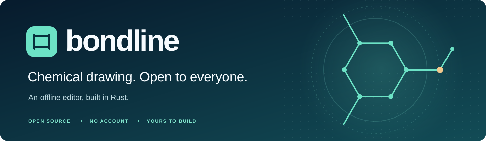
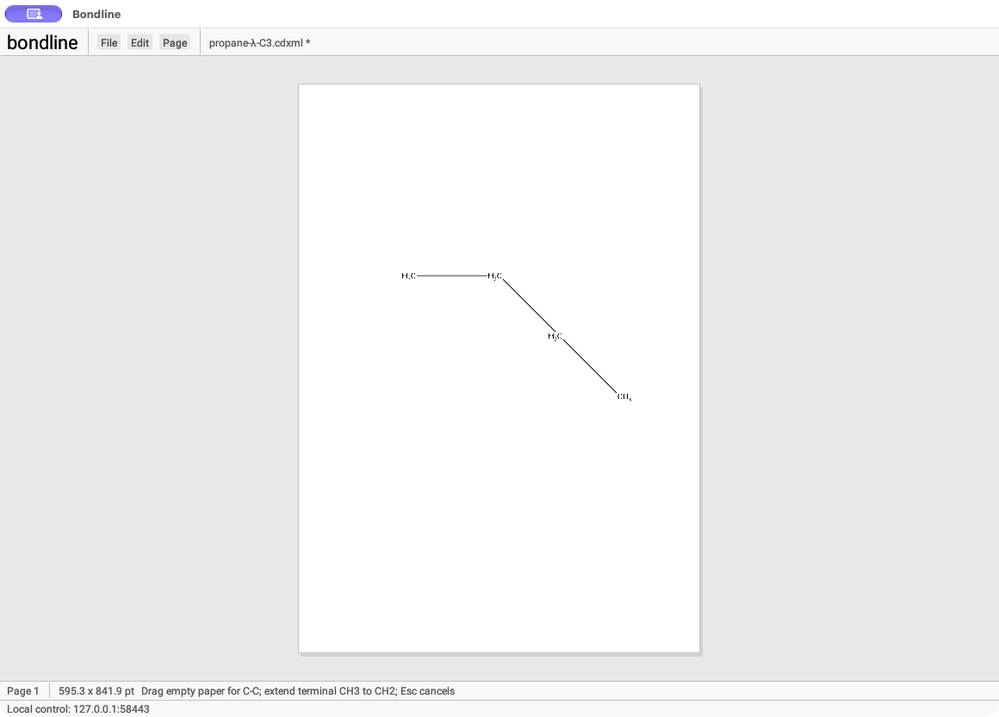
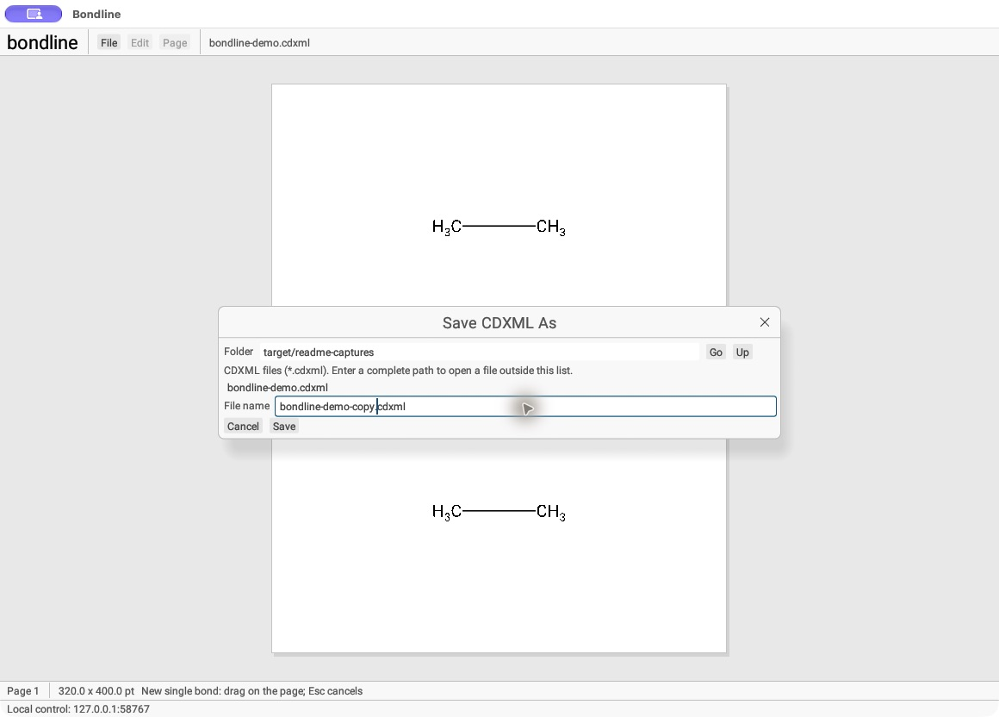
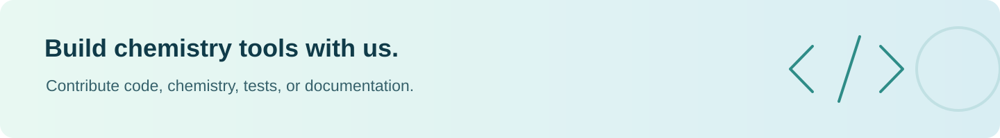

<p align="center">
  
</p>

<h1 align="center">Bondline</h1>
<p align="center">Free, open-source tools for drawing chemical structures and reactions.</p>

<p align="center">
  <a href="docs/ci.md"></a>
  <a href="LICENSE-MIT"></a>
  <a href="rust-toolchain.toml"></a>
  <a href="STATUS.md"></a>
</p>

<p align="center">
  <a href="#what-works-today">Features</a> ·
  <a href="#get-started">Get started</a> ·
  <a href="docs/README.md">Documentation</a> ·
  <a href="ROADMAP.md">Roadmap</a> ·
  <a href="CONTRIBUTING.md">Contributing</a> ·
  <a href="#license-and-credits">License</a>
</p>

Bondline is a native Rust desktop application with an offline command engine, editable
chemical documents and a thin egui/wgpu interface. No account or hosted service is needed
for ordinary drawing and saving.

**Early development:** draw C–C fragments and extend supported terminal carbons into
short single-bond chains. Rings, general labels and chemistry analysis are still being built.
M1 file interoperability is the active implementation milestone; the complete M1–M5 target
is in [ROADMAP.md](ROADMAP.md). Full M0 is not yet complete.

<p align="center">
  
  <br>
  <sub>Actual native terminal-carbon extension on macOS / Metal, build bb6d5b9.<br>Unedited capture; <a href="docs/media/SOURCES.md">build identity, scene and image provenance</a>.</sub>
</p>

## What works today

| Capability | Delivered scope |
|---|---|
| Drawing and history | Drag a C–C bond and extend a supported terminal carbon with an explicit H policy. Native C3/C4 authoring, Undo/Redo and editable CDXML reopening are verified on macOS; general chemistry remains missing. |
| Pages | A4 and Letter presets, rotation and validated physical dimensions. |
| CDXML files | Native Open, Save and Save As; editable reopening of proven Bondline-native files; unknown imported content remains backed by its original bytes. |
| MOL V2000 files | Source-preserving native Open/Save/Save As, retained headers/frame, explicit format choice and guarded close. Verified on macOS; one-fragment/layout/metadata limits apply. |
| MOL V3000 files | Native Open/Save/Save As and guarded close verified on macOS; retained source/headers, full-precision output and explicit versions. One-fragment/layout/metadata limits apply. |
| CDX files | Guarded native Open/Save/Save As verified on macOS, retaining exact accepted source. Limited projection; editing and faithful preview remain unavailable. |
| SDF files | Whole mixed-version collection Open/Save/Save As/reopen verified on macOS. CLI/MCP inspect ordered fields and edit existing values with Undo/Redo. Static summary only; chemical preview and field-edit UI remain missing. |
| File protection | Explicit overwrite, unsaved-change decisions, guarded retries and close-Save receipts. |
| Rendering | Shared CPU/GPU neutral-element graph scenes, literal authored H, hover and PNG captures; independent font checks and one approved carbon regression scene. New element-label native workflows remain unverified. |
| Automation | 22 typed commands in one registry, used by the UI, CLI, stdio MCP and opt-in authenticated localhost control. |

Native drawing/file workflows have been inspected on macOS. CI runs tests and actual
window smoke checks on macOS, Windows and Linux; interactive Windows/Linux workflows
remain unverified. [Verification evidence](docs/verification.md) distinguishes those scopes.

<table>
  <tr>
    <td width="50%" valign="top">
      <h3>Keep the document</h3>
      Supported CDXML opens and saves with source data retained. Unsupported imported edits
      fail explicitly. Atomic publication, overwrite confirmation and a saved baseline protect
      the delivered file workflow.
      <p><a href="docs/file-formats.md">Format capabilities and limits →</a></p>
    </td>
    <td width="50%" valign="top">
      <h3>Inspect every command</h3>
      The native menus and shortcuts use typed engine bindings. CLI and MCP discover the same
      command schemas; localhost control can address the actual desktop session.
      <p><a href="docs/control-protocol.md">Automation contract →</a></p>
    </td>
  </tr>
</table>

<p align="center">
  
  <br>
  <sub>The original CDXML chooser, captured from an earlier running build. The current chooser also offers explicit MOL versions.</sub>
</p>

## Get started

Source builds are available now. Signed installers and browser delivery are planned in M5;
there is no published installer release yet.

```sh
git clone https://github.com/thematheusmello/bondline.git
cd bondline
cargo run --locked -p bondline-ui --bin bondline
```

Rust **1.94.1** is pinned by the repository. Linux prerequisites and the independent test
environment are documented in [development.md](docs/development.md). Python is used for
independent developer test oracles, not as an application runtime.

Use File → Open/Save/Save As for supported CDXML, CDX, MOL or SDF documents. Cmd/Ctrl+O, S, Shift+S and W are wired;
actual Mac shortcut and accessibility-field evidence is in [native-file-ui.md](docs/native-file-ui.md).

```sh
# Discover the engine and the current control bindings.
cargo run --locked -p bondline-cli -- commands
cargo run --locked -p bondline-cli -- run --cmd '{"command":"ui.controls","params":{}}'

# Create a fragment through the same command used by the native canvas.
cargo run --locked -p bondline-cli -- run --cmd '{"command":"bond.create","params":{"page_id":1,"begin_x_pt":100,"begin_y_pt":200,"end_x_pt":140,"end_y_pt":200}}'

# Convert a supported 1–12 carbon path into a new CDXML file, preserving input.smi.
cargo run --locked -p bondline-cli -- run --cmd '{"command":"file.convert_smiles_to_cdxml","params":{"expected_revision":0,"input_path":"input.smi","output_path":"new.cdxml","bond_length_pt":48,"origin_x_pt":72,"origin_y_pt":72,"page_width_pt":612,"page_height_pt":792}}'

# Create and export one explicitly identified fragment in the same headless session.
cargo run --locked -p bondline-cli -- run --cmd '{"command":"bond.create","params":{"page_id":1,"begin_x_pt":100,"begin_y_pt":200,"end_x_pt":140,"end_y_pt":200}}' --cmd '{"command":"file.export_smiles_fragment","params":{"expected_revision":1,"page_id":1,"fragment_id":1,"output_path":"ethane.smi"}}'

# Run a process-local stdio MCP session.
cargo run --locked -p bondline-cli -- mcp
```

Headless sessions do not pretend to open native dialogs. `ui.file` requires an attached
native host; explicit file commands remain available headlessly. To control the desktop
session, start it with `--control-port 0` and follow the [authentication protocol](docs/control-protocol.md).
Its startup token is a credential; keep it out of reports and screenshots.

## Files and the road ahead

| Area | Current state | Next work |
|---|---|---|
| CDXML | Source preservation, checked attribute changes, native elemental encoding and the supported app workflow | Broader source-preserving edits and mappings |
| CDX | Guarded shared/native Mac Open/Save, exact source retention, limited elemental metadata view and standalone syntax/property/new-tree APIs, checked independently | Faithful preview, broader metadata/chemistry, safe edits/new encoding and foreign/general corpus |
| MOL / SDF | MOL V2000/V3000 and mixed-version SDF native Mac files, with independent byte/record/data checks; SDF summary has no chemical preview | Chemical preview/data-edit UI, broader metadata/layout support and interactive Windows/Linux |
| RXN | Source-preserving legacy container library with ordered roles and raw V2000/V3000 molecules; independent consumers | Reaction model, application/native files, V3000 reaction wrapper and broader extensions |
| SMILES | Explicit-H selected-fragment file export and restricted carbon-path→CDXML conversion through CLI/MCP/loopback, plus source/notation libraries, checked independently | Native export/conversion controls, source-backed application import, general layout/valence, aromaticity/stereo and canonicalization |
| InChI | Planned | Reference-tool comparison and import/export |
| Publishing | Page PNG capture exists | SVG/PDF/PNG publishing, printing and clipboard workflows |
| Web / installers | Planned M5 | Approved browser dependency graph, packaging and signing |

The compatibility target includes CDXML and CDX files used by ChemDraw Professional.
Bondline is independent and is not affiliated with, endorsed by or sponsored by ChemDraw
or Revvity Signals. Reference names identify compatibility; no reference icons, fonts,
templates or application assets are bundled.

## Engineering and verification

The engine is independent of the GUI. Cargo enforces the crate layers; standalone format
crates preserve unknown data. Complete document snapshots support history, and immutable
background plans keep I/O and rendering outside the engine lock.

After setting up the pinned [external test consumers](docs/development.md):

```sh
cargo fmt --all -- --check
cargo clippy --workspace --all-targets --locked -- -D warnings
cargo test --workspace --locked
cargo xtask ci
```

GitHub Actions is disabled during development to control costs. Run the local checks
above; hosted checks will be restored when the project is complete. See [CI policy](docs/ci.md).

The aggregate also checks layers, declared native dependency licenses, bundled assets and
the pinned corpus. Current corpus coverage is limited: a passing gate is not full format or
chemistry parity. Parser fuzzing has its own [bounded workflow](fuzz/README.md).

| Read | Purpose |
|---|---|
| [STATUS.md](STATUS.md) | Exact integrated checkpoint, evidence and next executable tasks |
| [ROADMAP.md](ROADMAP.md) | Complete M0–M5 target |
| [Architecture](docs/architecture.md) | Crate responsibilities, commands and data ownership |
| [Parity checklist](docs/parity-checklist.md) | Sourced feature inventory with explicit missing/wired/verified states |
| [Source register](docs/clean-room/sources.md) | Public specifications and provenance decisions |
| [CI evidence](docs/ci.md) | Actual platform results and their limits |

## Contribute

<a href="CONTRIBUTING.md"></a>

Chemists, Rust developers, documentation writers and test authors are welcome. Pick a
concrete gap, cite its public source and bring an independent test. Small contributions
are useful: a clear reproduction, an original licensed fixture or a corrected workflow
record can move the project forward.

Start with [CONTRIBUTING.md](CONTRIBUTING.md). Use the [issue forms](https://github.com/thematheusmello/bondline/issues/new/choose)
for bugs and feature requests, [SUPPORT.md](SUPPORT.md) for questions and
[SECURITY.md](SECURITY.md) for private vulnerability reporting. Parallel agent contributors
follow the same [AGENTS.md](AGENTS.md), file ownership and verification rules.

## License and credits

Original Bondline code and documentation are dual-licensed under **[MIT](LICENSE-MIT) OR
[Apache-2.0](LICENSE-APACHE)**, at your option. Copyright © 2026 Bondline contributors.

Third-party software and fonts retain their notices. See [NOTICE](NOTICE),
[ATTRIBUTION.md](ATTRIBUTION.md) and the [dependency policy](docs/dependency-policy.md).
The banners are original project artwork; the screenshots show Bondline itself.
Their [sources and hashes](docs/media/SOURCES.md) are recorded separately from the approved
render-test golden. No paid service or copied reference artwork is required.
