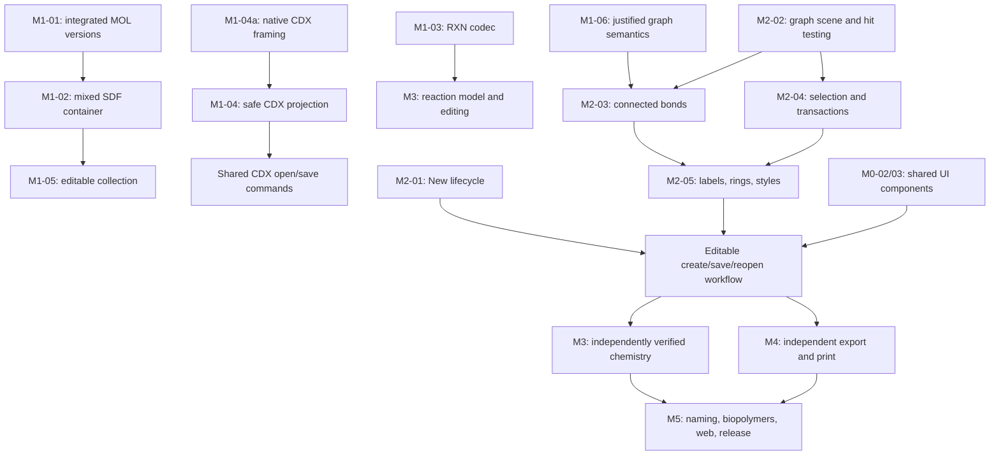

# Installed-reference implementation tickets

Reviewed 2026-11-14. These tickets carry the complete M0–M5 target forward from the
[installed feature map](installed-feature-map.md), [roadmap](../../ROADMAP.md),
[parity checklist](../parity-checklist.md) and [architecture](../architecture.md).
The [physical menu/dialog catalog](installed-menu-catalog.json) supplies stable installed
control IDs and state-qualified source evidence. These are implementation assignments,
not claims that listed commands or screens exist.
Quoted command names below marked **proposed** are not additions to the delivered registry.

## Starting contract

The current registry has thirteen commands: `document.inspect`, `document.close`, `ui.file`,
`ui.controls`, `document.open_cdxml`, `document.save_cdxml`, `document.open_mol`,
`document.save_mol`, `page.set_size`, `bond.create`, `history.undo`, `history.redo` and
`render.capture`. All adapters must call this shared typed registry. Use
`Engine::controls()` for delivered menu/shortcut/preset/enablement metadata, not another
UI binding table. Keep presentation intent distinct from trusted native file completion.

Verified variants include original native isolated C–C creation, three explicitly authored
H per carbon, bounded CDXML/MOL workflows, complete snapshot history and limited CPU/GPU
rendering. They do not establish connected drawing, general chemistry or full file parity.
The standalone CDX builder is not application CDX interoperability; ordered SDF is not an
application collection. Read current [STATUS.md](../../STATUS.md) before coding: the accepted
version-aware MOL application has now been integrated into `85bf5ebfd53580b66cde9726a374658fc9befcee`.
Its matching hosted run `43537753933` is GREEN: Mac 397, Linux 395 and Windows 387 tests,
native-window checks and five parser sanitizer targets. This completes that integration
slice, not M0/M1. SDF integration `23a43aa` is local GREEN and published with its own hosted
run still active; RXN source `c351bb8` has its local gate passing and publication pending.
Read STATUS for changes after this frozen research checkpoint.

Every ticket must retain source/model/baseline snapshots; bounded hostile-input handling;
failed-import retention; nonreused identity floors across undo branches; save reservation
through finish/drop; stale-result guards; and the native close publication barriers.
Do not bypass `StoredDocument::to_cdxml`, flatten an opaque source into its elemental
projection, regenerate the approved golden or replace an independent oracle with our own
round trip. No empty crates are needed to plan a future subsystem.

## Integration order and independent ownership

| Priority / ticket | Scope / initial status | Primary ownership and dependencies |
|---|---|---|
| P0 `M1-01` | Integrated main 85bf5eb, local/matching hosted GREEN | Complete bounded integration slice; retain acceptance contract below |
| P0 `M1-02` | Mixed source 6aeb9f2 reviewed/committed; integration 23a43aa local 401+3 GREEN, own hosted 43538842553 active | Existing worker/root; observe hosted outcome, do not duplicate container work |
| P0 `M1-03` | RXN c351bb8 local 410+3 GREEN; publication/integration checkpoint pending | Existing worker/root; no application reaction model implied |
| P0 `M1-04a` | Actual native CDX framing rejects with `TrailingData`; fix in progress after RED | Assigned format worker/root: `cdx` syntax/tests and independent framed vectors; fix before model import |
| P1 `M1-04` | CDX source-backed elemental model mapping; missing | Format/model worker after `M1-04a`: `cdx`, `io`; separate command/UI owner after a safe mapping exists |
| P1 `M1-05` | SDF application collection and record navigation; missing | Engine/UI owner after `M1-02` and reference collection-flow evidence |
| P1 `M1-06` | SMILES import/export and chemistry-safe graph interpretation; missing | Chemistry/format worker; independent OpenSMILES/RDKit oracle before UI |
| P1 `M1-07` | Remaining observed save-format families and explicit capability matrix; missing | Format researcher/owner after each public specification/oracle is qualified; do not alias unknown formats |
| Parallel M0 `M0-01` | Continue exact-build screens/control/flow inventory; incomplete | Reference investigator owns REA/CUA; map writer owns reconciliation; no overlapping GUI automation |
| Parallel M0 `M0-02` | Addressable native dialog fields/job discovery; partial host protocol | Command/native UI owner; preserve existing request, save and close contracts |
| Parallel M0 `M0-03` | Shared workspace/palette/dialog components and native host role audit; incomplete | UI/command owner after individual role evidence; original assets, current working flows preserved |
| Next lifecycle `M2-01` | Explicit New/reset authoring lifecycle; missing | Command/UI owner with reference New/dirty-state evidence; `MF-001`, `MF-019`, `KM-001` |
| Next drawing `M2-02` | General supported-graph scene and deterministic hit testing; missing | Renderer/model owner; independent geometry and CPU/GPU comparisons before connected gestures |
| Next drawing `M2-03` | Connect a bond to an existing atom; missing | Command/chemistry owner after `M2-02`; UI owner after shared tests; `TD-006`, `UI-005` |
| Then `M2-04` | Selection, transforms and coherent gesture transactions; missing | Engine/UI owner after hit testing; `TD-001/002`, selection/shortcut/context rows |
| Then `M2-05` | Bond order, labels, charges/isotopes/radicals, chains/rings and styles; missing | Small per-feature shared-command slices after graph/render/chemistry prerequisites |
| Then `M3-01` | Chemistry analysis/check/cleanup/stereo and reaction/text workflows; missing | Chemistry then engine/renderer/UI, each with independent numerical/format oracles |
| Then `M4-01` | Publishing, physical-scale printing and editable clipboard; missing | Export/native platform owners with independent consumers |
| Then `M5-01` | Naming, original templates, biopolymers, WASM and distribution; missing | Distinct offline engine/asset/web/release workstreams after complete prerequisite flows |
| Then `M5-02` | Optional search/add-in/cloud integration roles; missing | Adapter/plugin owner after lawful public API and offline-equivalent workflows are defined |

M1 remains the implementation priority; renderer/reference research can proceed independently
without claiming M2 delivered. Root alone assigns concrete worktrees, manages Git and runs
aggregate integration. Give workers exclusive file ownership and a shared interface before
editing; each worktree has its own Cargo target. Each format or command lands with its tests,
provenance and relevant docs in one small conventional commit. UI wiring can be a following
atomic commit once its shared command is complete.

These are implementation dependencies, not completion claims. Geometry/format work can be
parallel, but M1 remains the product-delivery priority. Highest-priority independent slices:

| Assignment | Exclusive starting files | First independent acceptance oracle / boundary |
|---|---|---|
| CDX native framing | `crates/cdx` syntax tests/parser; provenance coordinated by root | Published framing plus an original literal framed vector; actual ignored native file must parse and return identical bytes, existing junk/truncation/bounds negatives remain failures |
| SDF V3000 container | `crates/io/src/sdf.rs`, its tests/fuzz target; exports coordinated with root | Published CTfile, exact raw-record scanner and external RDKit per-record graph; all untouched bytes/duplicates preserved, no application collection claim |
| RXN receiving integration | Existing frozen RXN files after completed read-only review | Existing independent literal/consumer/fuzz evidence plus receiving-root aggregate; do not duplicate the worker or call the codec a reaction editor |
| Dialog discovery after current merge | `commands` presentation metadata/`controls.rs`, specific `ui/file_workflow` adapter after root grants ownership | Typed discovery addresses real delivered filename/format/cancel/save fields; stale/busy/close/error cases and actual native saved bytes agree; no new arbitrary file authority |
| General graph scene prerequisite | `render/{page,scene,label}.rs` and isolated geometry tests | Analytic chain/segment geometry and deterministic typed hit tests; independent CPU/GPU comparison; no approved-golden regeneration or UI-only chemistry |

M2 endpoint/ring/label work is not unblocked by a screenshot alone: graph mutation,
hydrogen/valence policy, general rendering and persistence must agree before native wiring.

## M1 acceptance tickets

### M1-01 — Integrate the accepted MOL application source

The code integration is now local and matching hosted GREEN at the source named above.
The following is its acceptance contract, not an instruction to
repeat the merge or duplicate the previous worker.

Use the published accepted branch and exact native report identified in STATUS, preserving
the fetched corpus and current save/close fixes. This integration is not a new behavior
needing an artificial RED test. Resolve additive code/docs, run the full gate against the
actual combined root, and attach its own source/hosted result. Repeat native workflows if
integration changes behavior. Never substitute a different checkout's binary or evidence.

Acceptance includes V2000/V3000 explicit/default version selection; exact unchanged source,
headers and coordinate frame; guarded precision/version conversion; malformed input keeping
the prior document; canceled/retried native work; and dirty close using the matching finished
save. Keep current one-page/fragment/layout/source-loss limitations explicit.

### M1-02 — Preserve ordered V3000 and mixed SDF records

An existing worker produced mixed-record source `6aeb9f2`; it is reviewed/committed and
receiving integration `23a43aa` passes 401 workspace plus three bridge tests locally.
Its published hosted run `43538842553` is active at this checkpoint. Observe that outcome
instead of starting another implementation. The RED/oracle and acceptance contract below
remains required for subsequent coverage; no application collection workflow is delivered.

First RED: a literal published-spec V3000 record inside SDF is rejected by the existing
V2000-only API, while its original bytes and ordered data items are independently known.
Use the already prepared bounded plan in `target/sdf-v3000-next-handoff.md`; check its
current ownership before editing. Published CTfile grammar, literal span assertions and
external RDKit per-record molecular consumption are separate oracles. RDKit's last-value
property map cannot verify duplicate/header/DT/empty-value preservation.

Implement bounded per-record version discrimination, source-preserving record spans and
explicit generic versus V2000-only writer contracts. Keep duplicate data items, original
headers, raw DT digits, empty/multiline values, opaque embedded MOL bytes and EOF rules.
Reject embedded reserved delimiter prefixes before output. Include mixed versions, sparse
IDs, malformed blocks, resource bounds and exact no-edit output. No application command
should silently pick the first molecule. Add corpus evidence only from a real hosted pin
with clear license/notice/hash, retaining all existing pins.

### M1-03 — Integrate RXN syntax without inventing reaction semantics

Read-only review is complete and RXN source `c351bb8` passes 410 workspace plus three bridge
tests locally. Publication/integration was pending at this checkpoint. Read its independent
literal/consumer/fuzz evidence identified in STATUS before making duplicate work; root owns
the receiving commit and matching hosted checks. These counts are checkpoint evidence, not
an RXN application/reaction-editor claim.
Preserve reactant/product order, source headers and embedded component bytes; reject invalid
counts/terminators/bounds without partial publication. A library RXN round trip does not
provide reaction placement, atom mapping or application save support. Those need the
reaction model and command ticket in M3, with an explicit intermediate representation.

### M1-04a — Accept the actual native framing before model mapping

The read-only parser probe at integrated source
`85bf5ebfd53580b66cde9726a374658fc9befcee` accepts the original 2,866-byte XML exactly but
rejects the original 1,196-byte binary with `Error::TrailingData`. Evidence manifest
`target/reference-ui/parser-probe-evidence.json`, SHA-256
`9abccee13251991010af4c73a86c8bc8edf78218378675025516e14f4003e864`, pins the probe/log and
independent decoder. Binary input SHA-256 is
`7b2b71338595ad12bc34f46459f8389ec6a63cb453b1cf29b51543717139a73c`; no trimming or changes
were made. This is a concrete current syntax blocker, not successful application CDX parity.

The independently decoded explicit document opens at offset 22, ends at 1194, and is followed
by a distinct two-byte file end through 1196. The published
[SDK introduction](https://iupac.github.io/IUPAC-FAIRSpec/cdx_sdk/IntroCDX.htm) describes a
28-byte header plus document object and separately a file end, so the compatibility framing
needs explicit source-backed treatment. Public BSD writer source at pinned
[CDXIO.cpp lines 696–706](https://github.com/Glysade/chemdraw/blob/5dd743230d75ecacacdf8dcd0b0e022f13173b9c/chemdraw/CDXIO.cpp#L696-L706)
explains its 22-byte prefix and six document-root bytes occupying the historical 28-byte
header. The corresponding
[document writer lines 1682–1700](https://github.com/Glysade/chemdraw/blob/5dd743230d75ecacacdf8dcd0b0e022f13173b9c/chemdraw/CDXDocument.cpp#L1682-L1700)
writes the document and separate file end. This is source evidence for framing, not code
to transplant. The assigned format worker is implementing a narrow library fix under TDD
in its isolated checkout; no delivered GREEN is asserted here.

First RED is the observed rejection plus an original independently specified literal framed
vector. Implement only justified framing, preserving exact input and existing canonical
writer behavior where promised. Retain exact-EOF negatives, reject extra file ends/junk,
account terminators before mutation and test inclusive byte/depth/record limits. Re-run the
actual unmodified native binary through standalone parse/write and independent record checks
after GREEN. No public fixture admission or unknown-property model editing is implied.

### M1-04 — Source-backed CDX model mapping, then application files

First RED: independently specified elemental CDX bytes decode into the exact expected
atom/bond IDs, orders, coordinates and source metadata while unknown object/property data
remain retained. Use published CDX property definitions, literal bytes and the existing
external consumer fixture; add foreign openly licensed evidence before claiming general
interoperability. No new dependency from the standalone `cdx` crate to the model.

Add `io` mapping and complete stored snapshots first. Unsupported properties/chemistry,
ambiguous references, duplicate IDs and unsupported containment must be explicit. Test
unchanged byte identity, failed mapping retaining the active document, source accounting,
undo/redo backing and guarded edits. A later proposed `document.open_cdx`/`save_cdx` slice
must use the shared file plans, CLI/MCP schemas, native format selection and close guards.
Never regenerate an imported file with the new canonical CDX syntax builder. New authored
CDX export requires a separately tested complete encoder and independent consumer.

### M1-05 — Make SDF records editable without losing the collection

Before UI design, observe the reference's Open/record-selection/save workflow on an original
test collection. Decide and document collection versus active-document ownership; do not
assume pages, fragments or a first-record-only import are equivalent. First RED must show
that editing one record preserves every other record and all ordered data fields.

Use stable record IDs, explicit active-record state and bounded collection snapshots. An
atomic record edit must undo/redo exactly and survive save/reopen through independent raw
and molecular consumers. Unknown component data stays guarded. Exercise navigation, empty
collections/records, malformed later records, cancellation and interrupted save. Then add
shared commands, CLI/MCP tests and a real native multi-record workflow. This depends on
`M1-02`; runtime observations can proceed independently.

### M1-06 — Implement SMILES semantics before format buttons

Use the linked OpenSMILES specification and independently justified chemistry rules from
the source register. Start with a named documented subset and explicit errors, not an
advertised complete parser. First RED should use literal external vectors covering atom
identity, branch/ring closure, bond order and authored/implicit H. Differential RDKit tests
check the promised graph; aromaticity, stereo, canonicalization and InChI remain separately
named capabilities until implemented. RDKit/InChI/OPSIN remain external test programs.

Retain unsupported source instead of silently erasing stereochemistry/query/isotope data.
Add fuzz limits, malformed input retention, source-aware snapshots and independent export
consumption. Wire explicit import/export and clipboard flows only after their semantics
and format/error/history contract exist. A parser-success result is not a chemistry engine.

### M1-07 — Close observed format families without invented compatibility

The actual native Save format popup exposes 28 named choices; its successful opening is
captured by `IR-SAVE-FORMAT-001`. Generic versus explicit V2000 MOL/SDF/RXN/RD entries are
separate controls. Do not equate the generic label with V3000, infer the selected encoder
from an extension, or claim format support because an item appears in a menu.

Keep a per-format/subset import/export/editability matrix covering native XML/binary/legacy/
stationery, CML, TGF, SKC, connection table, RD, MSI/SMD, raster/vector and two 3MF roles.
Existing M1/M4 tickets cover some families; these rows extend the backlog rather than
duplicate them. For each uncovered codec, find and cite a public specification or qualified
authorized behavior/file oracle, then write one literal externally consumed RED vector.
If evidence is unavailable, keep that format unknown and preserve the research question.
No renamed extension, opaque first-record projection or untested format handler satisfies
parity. Use one codec feature per commit and bounded lossless backing where applicable.

## M0 and M2 vertical slices

### M0-01 — Continue the runtime inventory

The first blank-state pass now reconciles all 14 exposed menu surfaces into 503 physical
records, including catalog choices/containers/headings. It is not a complete product or
context inventory. Use the schema/coverage board in the feature map. Expand menus, flyouts and dialogs on owned
documents; then capture complete success/cancel/error/persistence flows, including focus and
selection context. Match existing logical IDs conservatively. Require exact profile and
evidence locators before promoting candidate mappings. A screenshots-only pass does not
finish M0 or justify marking a workflow verified.

### M0-02 — Expose native presentation fields and jobs coherently

First RED: shared discovery cannot address a delivered format/path/overwrite/decoder field
or report an accepted running job without a UI-private convention. Inspect the current
protocol before adding metadata: already delivered request IDs, controls, host claims and
close barriers must not be reimplemented. Document which fields are host-only and why.

Add typed presentation metadata/operations through the registry, not arbitrary OS file
access. Test parameter closure, enablement, stale request rejection, busy-before-I/O,
cancel/retry, matching receipts, privacy and response draining through CLI/MCP/loopback.
Native acceptance must inspect the actual field and resulting bytes; a host acknowledgement
does not establish pixels. Keep token values out of every capture and record.

### M0-03 — Build reusable original workspace and palette components

The observed Mac Tools palette is a separate two-column utility window; its 63×583 logical
frame is one captured configuration, not a universal size/default. Its layer 3 requires an
explicitly recorded OS screenshot fallback because the cached REA helper filters layer 0.
Use actual role-labelled tooltips/actions before assigning any unlabelled glyph. Keep all
14 menu surfaces, three captured upper toolbars, dock/float behavior and contextual dialogs
in the component backlog; distinguish native window services from authored commands.

First RED for a supported control: menu, palette and shortcut all resolve the same registered
command/parameters/enablement, including busy/guarded-source/history states. Extend shared
control metadata only when a complete supported operation exists. Reusable menu, tool,
numeric field, property group, transient selection and job-status components must dispatch
the same engine contract. Do not ship a second callback registry or enable unimplemented
items to resemble the reference. Native host roles currently marked unknown in the catalog
need an actual Bondline platform audit before claiming they are missing or delivered.

Draw fresh procedural/vector glyphs from observed roles with Bondline branding and permissive
provenance. Verify keyboard focus, accessibility, high-DPI layouts, native floating-window
focus/close, toolbar state and working file workflows in the actual executable. A screenshot
does not establish a gesture or command. This UI/metadata work can be isolated from SDF/CDX
codec workers, but new chemical tools depend on M2 shared commands and renderer support.

### M2-01 — Explicit New and document lifecycle

The installed New control is stationery-dependent; `MF-001`/`MF-019` are candidate aliases.
Do not adopt a vendor stylesheet or infer its values from the menu label. Record actual
New/dirty prompt/window behavior before deciding single- versus multi-document UI parity.
Multi-document workspace ownership is a separate design decision, not a side effect of reset.

First RED for proposed `document.new`: a bounded current-document replacement retains the
old state when canceled, rejects stale file results, and creates the explicitly requested
original Bondline page/style only after the correct dirty-state decision. Specify whether
history is reset or retained from observed behavior; do not guess. Validate units/size,
source detachment, dirty/saved baseline, session identity floors and pending jobs. Test
CLI/MCP and trusted native New→edit→save→close→reopen. Keep application-close epochs out
of authored history. Wire the actual menu/binding through shared controls.

### M2-02 — General supported-graph rendering and hit testing

Existing rendering supports isolated C–C/three-H scenes; connecting the model alone would
not make the resulting drawing usable. First RED uses an independently specified carbon
chain geometry with known atom/bond coordinates and point-to-segment distances. Support
the already modelled graph without special-casing two atoms. Hit testing returns typed IDs
with deterministic tie-breaking and documented tolerance/zoom conversion; visual hover is
transient, not authored history. Hidden/unsupported chemistry must be explicit.

Compare CPU/GPU primitives and every RGBA byte for bounded scenes using independent geometry
expectations. Preserve the current approved single-bond golden and its hash. New goldens
need the required human approval before becoming references. Exercise high-DPI/zoom/page
transforms and boundaries in a real native app. Ownership: `render/{scene,page,label}.rs`,
model read APIs and a small UI adapter; no command/history changes in the renderer.

### M2-03 — Extend an existing atom with a bond

Public guide-25 `TD-006`/`UI-005` documents attachment; current installed click/drag/modifier,
length/angle and endpoint-hit rules still need runtime observation. Proposed `bond.extend`
must take a stable source atom ID and explicit geometric/style parameters, preserving the
current `bond.create` contract. No UI-only graph mutation or silent fallback to a new fragment.

First RED: an authored ethane endpoint extended by one carbon yields the independently
expected propane graph and hydrogen counts; invalid targets/geometry/source guards leave
the entire stored snapshot unchanged. Use published carbon valence rules plus external
RDKit graph/formula consumption; do not generalize implicit-H guesses to all elements.
Test identity exhaustion/nonreuse, branch undo/redo, source backing, bounds, file reopening
and exact supported CDXML/MOL encoding. One gesture must preview/cancel without authored
changes and commit one coherent history entry. Ordered native events must handle a drag
completed between frames. Test the same typed command via CLI/MCP, then the actual native
endpoint flow and undo/save/reopen; geometry tests alone do not verify the UI.

### M2-04 — Selection and transformations

Keep selection/hotspot/tool focus separate from authored data. First RED uses analytic
point/rectangle/polygon membership and typed graph identities, then an atomic translation
with an exact inverse. Establish whole-structure versus partial-atom context from runtime;
25.5 alignment screenshots are not complete 26.1 mixed-selection evidence.

Implement marquee/lasso, additive/toggle selection, delete and move as separate small
commands/transactions. Preserve graph invariants and attached data, reject guarded sources,
and make cancellation exact. Verify one-drag history, undo branches, file round trips,
keyboard focus and native modifier precedence. Do not advertise every `KP-*` or `KM-*`
binding from one modifier test. Selection persistence policy needs explicit evidence.

### M2-05 — Expand the drawing vocabulary incrementally

Use separate commits/tickets for order changes, element labels, chemical text, isotope/
charge/radical attributes, wedge/hash stereo, chain construction, ring insertion/fusion,
abbreviation expansion and document/object styles. Each starts with independent graph,
geometry or published journal-setting expectations, then shared command/error/history/
persistence tests, followed by renderer/UI/adapter verification. A label string is not
necessarily a chemical graph; nickname expansion and visual abbreviations are distinct.
Inspect focus/hotspot/modifier contexts before mapping `KA`, `KB`, `KG`, `KM` and `KP` rows.

## M3–M5 continuation contracts

`M3-01` splits into formula/mass and analysis; valence/structure diagnostics; aromaticity;
stereo perception/CIP; 2D cleanup; reactions/mapping/arrows; brackets; and captions with
chemical formatting. Define numerical tolerances and published scientific reference
vectors first. Compare corpus structures with external RDKit/reference InChI and names
with OPSIN as applicable. Analysis-panel visibility does not verify chemical values.
Arrows/text must survive supported editable formats without overwriting opaque source.

`M4-01` splits SVG, PDF, PNG publication, physical-scale printing and platform clipboard
formats. Document exact import/export/editability/scale/axes/format support. Verify outputs
with independent parsers/consumers and native Word/PowerPoint workflows where public format
documentation permits. `render.capture` is a scene capture, not complete publishing or an
editable clipboard implementation. Unsupported native/container fields must be reported.

`M5-01` splits offline naming, original templates/assets, biopolymer/HELM authoring, WebAssembly,
platform packaging/signing and release readiness. Inventory advanced desktop capabilities
without silently moving them outside scope. Keep account/cloud integrations distinct from
equivalent offline creation workflows. Validate license/notices for each shipped dependency
and asset under the existing allowlist; browser build/launch and installer signatures need
their own platform evidence. Readme banners/photos, licenses and contributing/community
documents already exist; extend those records as capabilities land instead of duplicating
boilerplate. Public publication or release actions remain separate from local implementation.

`M5-02` retains the installed Search, Signals and Add-ins roles in the backlog, with their
observed enabled states and exact source profile. Reference web/commerce/account controls
do not become mandatory Bondline dependencies. Investigate public APIs and independently
implement equivalent optional adapters where lawful and useful; use original labels/branding.
Record blocked entitlement/network behavior without bypassing it. Ordinary offline drawing,
chemistry, files and publishing must remain complete without those integrations. Do not mark
the reference integration tested merely because its menu was visible.

## Definition of a completed ticket

Record the independent expectation and actual RED command/result, minimal implementation,
GREEN verification and any native/consumer evidence in the normal provenance/verification
records. Run relevant checks, then the aggregate receiving-root gate for integration.
Update the existing logical parity row with its exact variant, command/model/UI locations,
limitations and evidence. A ticket is `wired` while any promised behavior lacks decisive
evidence; a native/platform claim stays unverified when that platform did not run. Keep the
remaining full target visible and leave exact next work/owned job handles in STATUS.
